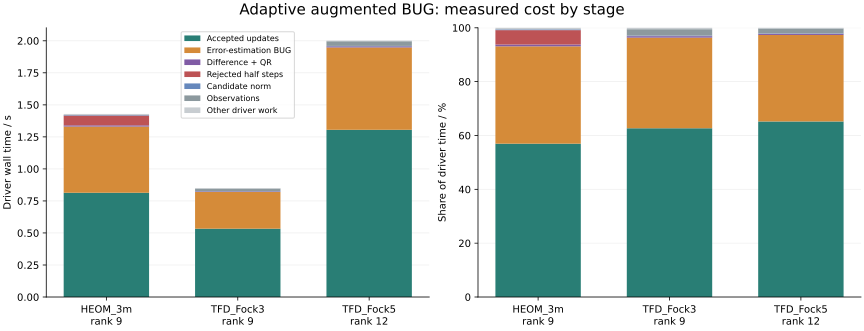

# Adaptive integration timing

The standard workflow uses a prescribed time step and checks convergence with half that step. Adaptive integration remains available for choosing time steps and for changing time scales.

These measurements use the actual adaptive HEOM/TFD APIs with `record_timing=true`. Both paths are warmed up by complete runs, then timed and untimed runs alternate. GC is enabled; an explicit collection precedes each measured call. No tests, dense reference work or plotting run concurrently with the measurements.

```text
Measured: 2026-11-05T10:03:10.529
Julia: 1.12.6
CPU: AMD Ryzen Threadripper PRO 9985WX 64-Cores
Julia threads: 1
BLAS threads: 1
BLAS: LBTConfig([ILP64] libopenblas64_.so)
Repetitions: 5
Two full warmups per case; alternating timed/untimed runs; GC enabled.
```

HEOM: three hierarchy modes of size 3, t=0–10, save interval 0.2, initial dt=0.2, atol=1e-8, rtol=1e-5, no trace correction. TFD: the two-site 300 K Holstein example, t=0–50 fs, save interval 1 fs, initial dt=2 fs, atol=1e-9, rtol=1e-5; Fock cutoffs 3 and 5. Steps land on each output time. Fock size 5 has no dense accuracy check in this benchmark.

## Measurements

Each breakdown is the actual repetition nearest the median driver time. Ranks are the maximum saved rank and maximum temporary augmented rank. The driver total excludes generator construction and TFD initial enrichment; the outer wall times saved in the CSV include these wrapper operations. Model construction is outside both measured intervals.

| Case | Saved / augmented rank | Accepted / rejected | Driver median (range), s | Timing on/off wall ratio |
|---|---:|---:|---:|---:|
| HEOM_3m | 9 / 9 | 87 / 12 | 1.4289 (1.3385–1.4798) | 0.999 |
| TFD_Fock3 | 9 / 11 | 50 / 0 | 0.8509 (0.8459–0.8548) | 0.976 |
| TFD_Fock5 | 12 / 24 | 50 / 0 | 2.0014 (1.8904–2.0887) | 0.986 |

| Case | Error-estimation BUG | Difference + QR | Accepted updates | Rejected half steps | Other |
|---|---:|---:|---:|---:|---:|
| HEOM_3m | 36.2% | 0.7% | 57.0% | 5.3% | 0.9% |
| TFD_Fock3 | 33.7% | 0.5% | 62.7% | 0.0% | 3.1% |
| TFD_Fock5 | 32.1% | 0.4% | 65.2% | 0.0% | 2.2% |

Other combines candidate-norm QR, observation snapshots/callbacks and driver bookkeeping; the CSV and figure keep these separate. Difference + QR measures the complete `ttn_distance` call, including construction of the temporary difference tensor. The two half steps are classified as accepted updates only after acceptance; rejected work and failed local solves are included in the accounting.



## Optimization targets

- HEOM_3m: the largest measured error-control cost is **Error-estimation BUG** (36.2% of driver time).
- TFD_Fock3: the largest measured error-control cost is **Error-estimation BUG** (33.7% of driver time).
- TFD_Fock5: the largest measured error-control cost is **Error-estimation BUG** (32.1% of driver time).

Shared BUG preparation and local contraction workspaces are evaluated in the [before/after optimization report](bug_preparation.md). Removing the extra full step would require a validated alternative time-error estimator; the stage breakdown alone does not establish the speedup of a proposed change. Larger ranks, different operators or output intervals can change the relative costs. Timing on/off ratios include run-to-run noise.

## Numerical checks

All timed/untimed pairs have identical saved times and acceptance/rejection histories, with final-state TTN distance below 1e-11 times max(1, norm(state)).

| Case | Maximum timing-on/off state difference | Final dense relative error |
|---|---:|---:|
| HEOM_3m | 3.462e-16 | 5.262e-06 |
| TFD_Fock3 | 1.281e-15 | 1.669e-05 |
| TFD_Fock5 | 5.170e-16 | not measured |

## Reproduce

From the TTNDynamics package root:

```sh
OPENBLAS_NUM_THREADS=1 julia --startup-file=no --project=examples benchmarks/adaptive_timing/run.jl 5
python3 benchmarks/adaptive_timing/plot.py
```

Raw data: [runs.csv](../benchmarks/adaptive_timing/data/runs.csv), [attempts.csv](../benchmarks/adaptive_timing/data/attempts.csv). Repeating the benchmark replaces these files, the figures and this report.
