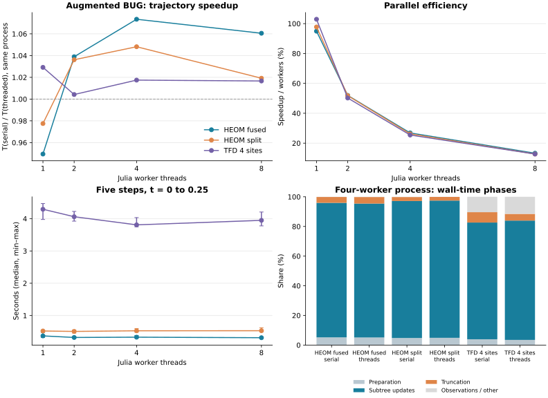

# Augmented BUG thread scaling

Augmented BUG now updates independent sibling subtrees concurrently. A parent waits for both updated child bases before its Galerkin solve. This changes scheduling, not the integration formula. Both fixed and adaptive HEOM/TFD APIs honor `threaded=true` (default); `threaded=false` runs sequentially. Start Julia with `--threads=N`. The one-worker path falls back to sequential execution.

```julia
result = heom_evolve(system, initial, 0:0.05:0.25;
                     method=:augmented, threaded=true)
# The same options apply to tfd_evolve and adaptive keyword time spans.
```



## Measurement

Julia 1.12.6, AMD Ryzen Threadripper PRO 9985WX, KrylovKit 0.10.4; BLAS and GC each use one thread. Separate processes use 1, 2, 4, and 8 Julia workers. Each case has two warmup trajectories per mode, followed by five alternating serial/threaded pairs; explicit GC is outside timing, while GC during evolution is included. The host is shared: ranges show observed variability, not confidence intervals.

Each trajectory has five fixed steps (`h=0.05`, `t=0…0.25`), absolute truncation budget `1e-10`, `maxrank=64`, and default Krylov settings. Timings include every step's preparation, updates, truncation and observable contractions, but exclude model construction and TFD's initial `H*initial` basis enrichment. No dense hierarchy/state is constructed. Allocations are cumulative, not peak memory. This measures early rank growth; longer trajectories can have different ranks and scaling.

HEOM has system dimension M=4 and eight hierarchy modes, each of size 3 (fused and split layouts). TFD has four sites, eight thermal modes and Fock size 3. All three global state spaces have 104,976 complex entries; tree leaves/terms and actual rank sizes differ. The previous small cases were M=4/six size-2 HEOM modes (1,024 entries) and three-site/size-2 TFD (576 entries). These cutoff choices define performance workloads, not converged bath/Fock models.

## End-to-end scaling

The same-process median speedups with 2–8 workers are only about 1.00–1.07×, with overlapping timing ranges. These workloads show no substantial scalable speedup. Four workers deliver roughly 25–27% efficiency and eight workers about 13%. Between-process load variation matters: for example, the serial TFD median differs between the one- and four-worker processes even though both execute sequentially.

Speedup is the serial median divided by the threaded median from the same process; efficiency is that speedup divided by the worker count. The last column also gives the conventional one-worker serial baseline ratio for comparison. GC and BLAS thread counts are fixed in both modes.

| Case | Workers | Serial s | Threaded s (min–max) | Same-process speedup | Efficiency | 1-worker baseline ratio |
|---|---:|---:|---:|---:|---:|---:|
| HEOM fused | 1 | 0.351 | 0.370 (0.321–0.478) | 0.95× | 94.9% | 0.95× |
| HEOM fused | 2 | 0.334 | 0.321 (0.303–0.344) | 1.04× | 51.9% | 1.09× |
| HEOM fused | 4 | 0.354 | 0.330 (0.316–0.383) | 1.07× | 26.8% | 1.07× |
| HEOM fused | 8 | 0.333 | 0.314 (0.295–0.336) | 1.06× | 13.3% | 1.12× |
| HEOM split | 1 | 0.510 | 0.522 (0.486–0.529) | 0.98× | 97.8% | 0.98× |
| HEOM split | 2 | 0.527 | 0.509 (0.457–0.553) | 1.04× | 51.8% | 1.00× |
| HEOM split | 4 | 0.554 | 0.528 (0.486–0.598) | 1.05× | 26.2% | 0.97× |
| HEOM split | 8 | 0.541 | 0.530 (0.499–0.622) | 1.02× | 12.7% | 0.96× |
| TFD 4 sites | 1 | 4.416 | 4.291 (3.974–4.468) | 1.03× | 102.9% | 1.03× |
| TFD 4 sites | 2 | 4.077 | 4.060 (3.923–4.224) | 1.00× | 50.2% | 1.09× |
| TFD 4 sites | 4 | 3.874 | 3.808 (3.747–4.033) | 1.02× | 25.4% | 1.16× |
| TFD 4 sites | 8 | 4.013 | 3.948 (3.777–4.205) | 1.02× | 12.7% | 1.12× |

## Numerical checks

Every pair checks the final full-TTN distance with local contractions, sampled density matrices, complete saved rank history, and every truncation pass/fail flag. Root trace correction is disabled; TFD has no norm correction.

| Case | Max kept / augmented rank | Largest local dimension | Truncation misses / 5 | Max invariant drift | Serial/thread distance | Allocated GB (4 workers) |
|---|---:|---:|---:|---:|---:|---:|
| HEOM fused | 32 / 32 | 15360 | 0 | 2.33e-15 | 4.85e-16 | 0.32 |
| HEOM split | 32 / 32 | 15360 | 0 | 3.33e-15 | 4.22e-16 | 0.48 |
| TFD 4 sites | 44 / 65 | 66560 | 0 | 1.44e-14 | 1.46e-15 | 3.41 |

A truncation miss means the chosen rank cap did not meet the per-step budget. These runs establish concurrency equivalence and performance; they do not establish time/rank convergence or global physical accuracy.

## Wall-time breakdown

Separate instrumented runs in a four-worker process report three repetitions per mode. Instrumentation is inserted into an isolated source copy, checked against the ordinary solver, and is absent from the main scaling runs. Subtree updates include basis construction, local ODEs, upward contractions and result publication. Root ODE time is part of updates and cannot overlap with its descendants; it is shown separately, not added again.

| Case | Execution | Preparation s | Updates s | Truncation s | Observations / other s | Root ODE s |
|---|---|---:|---:|---:|---:|---:|
| HEOM fused | serial | 0.017 | 0.303 | 0.013 | 0.000 | 0.013 |
| HEOM fused | threaded | 0.016 | 0.278 | 0.014 | 0.000 | 0.012 |
| HEOM split | serial | 0.025 | 0.476 | 0.014 | 0.001 | 0.020 |
| HEOM split | threaded | 0.027 | 0.502 | 0.013 | 0.000 | 0.020 |
| TFD 4 sites | serial | 0.164 | 3.286 | 0.292 | 0.433 | 0.027 |
| TFD 4 sites | threaded | 0.138 | 3.177 | 0.178 | 0.455 | 0.025 |

The following serial measurements show how unevenly local ODE work is distributed. Shares use medians of accumulated per-node solve times across the five steps; workspace construction and basis algebra are outside these solve timers.

| Case | Most expensive node | Its local ODE time s | Share of all local ODE time |
|---|---:|---:|---:|
| HEOM fused | 16 | 0.183 | 72.1% |
| HEOM split | 18 | 0.295 | 72.0% |
| TFD 4 sites | 16 | 2.446 | 91.8% |

In these measurements one internal core accounts for about 72% of local ODE time in each HEOM layout and 92% in TFD. The primary limitation is concentrated work: that single solve is sequential, and subtree scheduling cannot divide it among workers. Preparation and truncation also remain serial, but do not explain most of the measured time. Optimizing that core's contraction/Arnoldi action is a more useful next target than increasing the subtree worker count for these cases.

Dependencies from leaves to root, uneven subtree costs, memory allocation and task overhead limit scaling; increasing the thread count does not remove these costs. Parallel BUG is a distinct algorithm that solves all node equations in old bases, so its timing/accuracy tradeoff should be evaluated separately. Small timing differences here are comparable to run-to-run variation; use one worker or `threaded=false` for these workloads unless a measurement of the actual model shows a benefit.

The [parallel BUG scaling study](parallel_threads.md) measures the same fixtures,
time interval and worker counts with the parallel BUG formula.

## Reproduce

From the TTNDynamics package root:

```sh
for n in 1 2 4 8; do
  OPENBLAS_NUM_THREADS=1 JULIA_NUM_GC_THREADS=1 julia --threads=$n --project=. benchmarks/augmented_threads/run.jl 5
done
OPENBLAS_NUM_THREADS=1 JULIA_NUM_GC_THREADS=1 julia --threads=4 --project=. -e 'include("benchmarks/augmented_threads/run.jl"); include("benchmarks/augmented_threads/stages.jl"); benchmark_stages()'
python3 benchmarks/augmented_threads/plot.py
```

Raw [timings, diagnostics and environment/source hashes](../benchmarks/augmented_threads/data/), [runner](../benchmarks/augmented_threads/run.jl), and [phase instrumentation](../benchmarks/augmented_threads/stages.jl) are retained. Node solve times are elapsed durations; their sum is not parallel wall time. GC worker count is fixed explicitly because Julia otherwise changes it with the worker count.

## References

1. G. Ceruti, C. Lubich and D. Sulz, *Rank-adaptive time integration of tree tensor networks*, SIAM J. Numer. Anal. 61(1), 194–222 (2023), [doi:10.1137/22M1473790](https://doi.org/10.1137/22M1473790).
2. G. Ceruti, J. Kusch, C. Lubich and D. Sulz, *A Parallel Basis Update and Galerkin Integrator for Tree Tensor Networks*, SIAM J. Sci. Comput. 48(1), A27–A48 (2026), [doi:10.1137/24M1714502](https://doi.org/10.1137/24M1714502).
