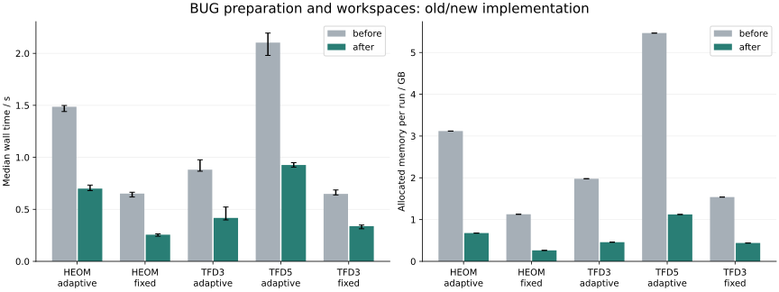

# BUG preparation and local workspaces

The full step and first half step start from the same state. They now share its orthogonalization, old operator contractions, recursive complement QR factorizations and reduced initial data. Updated bases are owned by each solve. The second half step prepares its changed input independently. Preparation lives for one trial; no persistent cache or public API is added. An unnecessary deep copy of old operator contractions was also removed from every BUG step.

Local Krylov actions now reuse private scratch arrays for mode permutations and matrix products. Each operator application still returns a fresh result because Arnoldi retains earlier outputs. Scratch storage is scoped to a single sequential local solve and is never shared between branches. This also benefits fixed stepping. Profiling identified repeated core contractions and array allocation as the next target after preparation reuse alone gave small timing gains.

The integration formula, truncation budgets, local solves and acceptance test are unchanged. Fixed stepping remains the standard workflow.

## Measurements

The old source snapshot and current solver run in the same Julia process, using identical model wrappers. Each case has two full warmups per version; measured pairs alternate order. GC remains enabled, with explicit collection outside each measured call. Times include wrapper setup and observations, excluding model construction and numerical comparisons. Adaptive cases enable stage timing in both versions; fixed cases have no stage timers.

```text
Measured: 2026-11-05T10:30:23.363
Julia: 1.12.6
CPU: AMD Ryzen Threadripper PRO 9985WX 64-Cores
Julia threads: 1
BLAS threads: 1
BLAS: LBTConfig([ILP64] libopenblas64_.so)
Repetitions: 5
KrylovKit: 0.10.4
before TTNSolver.jl sha256: 4996b09626c4a8a4c673f838c3bd609e4cbc09104096f21b2b88c80dbeab3eae
before bug.jl sha256: f79acf62d6fb33c71157bccb38cff4fcbc4712fda03bb18fa3d7c4f89d2348f3
before adaptive.jl sha256: 59623ea908f713872a9045f747a6896de239bc2edf24e4a3e75c4d0ac2e40654
before bug_workspaces.jl sha256: absent
after TTNSolver.jl sha256: 28efc8f827f59b7bb6035635f39fcb9bfcd26e5fc7954d3d6dea03744c51c49a
after bug.jl sha256: 75ee9988755fb722574a829fccbedddbc3d0753328dca8eb760ba77f8656d984
after adaptive.jl sha256: 262a68f1b46377c29e83e290cd1ae2b2f9c46989118d8c33227b221e22727460
after bug_workspaces.jl sha256: 69b960c079be6fa97550c99ba5834f9fbb95c579b922df1ea3f7943156fc6051
```

HEOM uses three hierarchy modes of size 3, t=0–10, no trace correction. Adaptive: initial h=0.2, output interval 0.2, atol=1e-8, rtol=1e-5; fixed: h=0.1, truncation atol=1e-10. TFD uses the two-site 300 K Holstein model, four transformed modes, t=0–50 fs, Fock sizes 3 and 5. Adaptive: initial h=2 fs, output interval 1 fs, atol=1e-9, rtol=1e-5; fixed: h=0.5 fs, truncation atol=1e-10. Steps land on observation times.

Wall times and allocated bytes below are medians; allocation is cumulative, not peak resident memory. Error bars in the figure show minimum–maximum.

| Case | Before, s | After, s | Speedup | Allocation reduction | Accepted / rejected | Max rank |
|---|---:|---:|---:|---:|---:|---:|
| HEOM_adaptive | 1.4861 | 0.6993 | 2.125× | 78.3% | 87 / 12 | 9 |
| HEOM_fixed | 0.6515 | 0.2563 | 2.542× | 76.7% | 100 / 0 | 9 |
| TFD3_adaptive | 0.8817 | 0.4178 | 2.110× | 76.8% | 50 / 0 | 9 |
| TFD5_adaptive | 2.1034 | 0.9268 | 2.270× | 79.5% | 50 / 0 | 12 |
| TFD3_fixed | 0.6484 | 0.3385 | 1.915× | 71.4% | 100 / 0 | 9 |



Shared preparation is charged once to `coarse_bug`. The time saved by reusing it appears in `accepted_update` / `rejected_update`, since the first half step no longer repeats setup. Phase medians below are independent and need not sum to a particular run's wall time.

| Case | Error-estimation BUG, before → after (s) | Accepted updates, before → after (s) | Difference + QR, before → after (s) |
|---|---:|---:|---:|
| HEOM_adaptive | 0.5622 → 0.2189 | 0.8391 → 0.4323 | 0.0093 → 0.0083 |
| TFD3_adaptive | 0.3076 → 0.1463 | 0.5413 → 0.2486 | 0.0046 → 0.0045 |
| TFD5_adaptive | 0.6783 → 0.3066 | 1.3263 → 0.5578 | 0.0129 → 0.0086 |

## Numerical checks and limits

Every warmup and measured pair checks saved times, ranks, and (for adaptive runs) identical step sizes and acceptance/rejection histories. Densities and other saved observables agree within 1e-11; the final dense state comparison is performed outside timing. This compares implementations, not convergence to an infinite Fock space or an independent dense evolution.

| Case | Maximum saved density difference | Maximum relative final-state difference |
|---|---:|---:|
| HEOM_adaptive | 0.000e+00 | 0.000e+00 |
| HEOM_fixed | 0.000e+00 | 0.000e+00 |
| TFD3_adaptive | 0.000e+00 | 0.000e+00 |
| TFD5_adaptive | 0.000e+00 | 0.000e+00 |
| TFD3_fixed | 0.000e+00 | 0.000e+00 |

The result applies to these small-rank models and this machine. The full error-estimation solve and both half-step solves still run. Further speedups require profiling their local contractions, Krylov actions and truncations. Replacing step doubling would change the error estimator and needs separate numerical validation.

## Reproduce

From the package root, with a pre-change solver `src` snapshot:

```sh
OPENBLAS_NUM_THREADS=1 julia --startup-file=no --project=examples benchmarks/bug_preparation/run.jl /path/to/baseline/src 5
python3 benchmarks/bug_preparation/plot.py
```

The baseline snapshot used for this run was `/tmp/ttn-bug-before-20261105/src`. It is a local temporary artifact; the source hashes above identify the measured versions. [Raw results](../benchmarks/bug_preparation/data/runs.csv) are retained with this report. Re-running replaces the data, figures and report.
