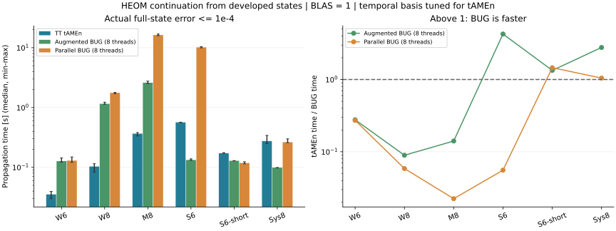

# HEOMの必要ランクとBUG系の速度

前回のTTランク10は上限制約ではなく、弱い相関のモデルで観測されたランクだった。
今回、より高いランクが必要な状態を用意し、tAMEnとaugmented / parallel BUGを比較した。
TFDは対象外。比較基準は引き続き、全スケール済みADOの終端相対2ノルム誤差1e-4以下。

**ランクが上がるとBUGが勝つ例はあるが、ランクだけで決まらない。**
S6ではaugmented BUGがtAMEnの4.26倍速い。
同じ入力状態・生成子で区間を0.05から0.005へ短くしたS6-shortでは、
tAMEn時間 / parallel BUG時間は1.46となった。
一方、より多いモードで圧縮が効くW8・M8では、tAMEnが速い。

## 本計測

3回の中央値。tAMEnは逐次スイープ、BUGは8 Juliaワーカー。
BLAS・Strided・GCは1。TTNランク欄はaugmented BUGの値。

| ケース | 区間長 | 最終ランク TT / TTN | tAMEn 秒 | augmented BUG 秒 | parallel BUG 秒 |
|---|---:|---:|---:|---:|---:|
| W6: 弱結合・6モード | 0.05 | 32 / 18 | 0.035 | 0.127 | 0.130 |
| W8: 弱結合・8モード | 0.05 | 39 / 31 | 0.103 | 1.153 | 1.761 |
| M8: 中結合・8モード | 0.05 | 61 / 48 | 0.366 | 2.597 | 16.302 |
| S6: 強結合・6モード | 0.05 | 81 / 27 | 0.566 | 0.133 | 10.157 |
| S6-short: 同じ状態・短区間 | 0.005 | 81 / 27 | 0.172 | 0.129 | 0.118 |
| Sys8: M=8・4モード | 0.05 | 64 / 65 | 0.275 | 0.099 | 0.263 |

## 何が効いているか

1. TTとTTNでは切断面が違う。S6ではTTランク81に対しTTNは27で、同じ状態でも
   必要な結合次元が異なる。高いTTランクを小さいTTNランクで表せる条件はBUG側に有利。
2. 同じTTNランクでも時間離散化誤差は異なる。S6のaugmented BUGは1ステップで基準を満たすが、
   parallel BUGは試した1・2・4…の刻みでは64ステップが最初の合格設定だった。
   全ノードを並列化できても、これで時間を失う。
3. S6-shortは初期状態も生成子もS6と同じで、区間長だけを変えた。
   短区間ならparallel BUGも1ステップで基準を満たすため、繰り返しの費用が減る。
   ただし、これを長時間伝播の速度比と読み替えてはいけない。
   一定生成子で長区間をまとめて解けるtAMEnを、出力点のためだけに毎回再起動する必要はない。
4. 高ランクであってもTTN内部コアの処理は重くなる。W8・M8は反例であり、
   「高ランクならBUGが必ず速い」という結果ではない。

S6やSys8は小さい全空間に対してほぼ全ランクとなり、テンソル形式の格納量が密表現を超える。
これは有限サイズでのアルゴリズム比較であり、巨大で十分に圧縮された高ランクHEOMにおける
BUGの優位性を実証したものではない。通常の疎行列伝播との優劣も本表からは結論しない。

## モデルと計時範囲

前回の対角結合モデルとは異なる制御モデル。乱数種119で生成したHermitian結合行列を
各モードで演算子ノルム1に規格化する。非可換な結合を採用し、相関を増やした。
Hは隣接ホッピング0.25±0.07iと対角成分-0.2…0.2、浴減衰率0.8…1.5。
係数は倍率×(0.08+0.01i)×8/K、逆向き係数は複素共役。全モードの局所次元3、系はfused。

| 記号 | ケース | M | 浴モード数 | 結合係数倍率 | 準備時刻 | 区間長 | 入力ランク TT / TTN |
|---|---|---:|---:|---:|---:|---:|---:|
| W6 | 弱結合・6モード | 4 | 6 | 1.0 | 0.25 | 0.05 | 30 / 18 |
| W8 | 弱結合・8モード | 4 | 8 | 1.0 | 0.25 | 0.05 | 42 / 30 |
| M8 | 中結合・8モード | 4 | 8 | 4.0 | 0.25 | 0.05 | 70 / 47 |
| S6 | 強結合・6モード | 4 | 6 | 16.0 | 0.5 | 0.05 | 79 / 27 |
| S6-short | 同じ状態・短区間 | 4 | 6 | 16.0 | 0.5 | 0.005 | 79 / 27 |
| Sys8 | M=8・4モード | 8 | 4 | 16.0 | 0.5 | 0.05 | 64 / 64 |

全ADOの疎行列Krylov計算（tol=1e-12）で準備状態と終端参照解を求める。
準備状態をTT・TTNにそれぞれ圧縮（1e-5）し、圧縮誤差を含めた終端誤差で判定する。
両入力が数値的に完全に同じ配列という意味ではなく、同じ物理的準備状態の近似である。
入力誤差の上限チェックも行う。圧縮1e-7で調べた `profile_*.csv` のランクは
本計測の入力ランクと区別する。

tAMEnの時間方向4・8・12点を試し、誤差基準を満たす条件のウォーム済み計測から設定を選ぶ。
BUGの固定刻みも実測誤差で選択し、トレース保護に必要な追加基底をランク上限に許容する。
各手法の内部tolは同じ値にそろえない。試した有限の設定格子での比較であり、
各手法の絶対的最速設定を保証するものではない。

準備状態の生成・圧縮、MPO構築、参照解、誤差評価は計時外。
時間発展内の準備・局所解・切り捨て・tAMEnの終端解抽出は計時内。
各手法を1回ウォームアップし、実行順を回して3回測定する。
共有ホスト上の最小–最大は観測範囲であって信頼区間ではない。
局所切り捨て予算を超えた場合も、全状態の実測誤差で採否を決め、超過回数をCSVに残す。
階層打切りの物理的収束は調べていない。

## 設定・精度・格納量

格納量の比は、テンソルの複素数要素数 / 全ADOの複素数要素数。ワークスペースやピークメモリではない。

| ケース / 手法 | 設定 | 実測相対誤差 | 時間の最小–最大 秒 | 状態格納量 / 密表現 |
|---|---|---:|---:|---:|
| W6 / tamen | Chebyshev 12点, tol=1e-04 | 6.22e-05 | 0.030–0.040 | 0.659 |
| W6 / augmented | 1ステップ, maxrank=18, atol=1e-8 | 1.67e-05 | 0.122–0.144 | 0.619 |
| W6 / parallel | 2ステップ, maxrank=18, atol=1e-8 | 8.48e-05 | 0.121–0.149 | 0.619 |
| W8 / tamen | Chebyshev 12点, tol=1e-04 | 6.95e-05 | 0.083–0.115 | 0.152 |
| W8 / augmented | 1ステップ, maxrank=31, atol=1e-8 | 9.99e-06 | 1.137–1.230 | 0.212 |
| W8 / parallel | 4ステップ, maxrank=31, atol=1e-8 | 5.11e-05 | 1.699–1.794 | 0.212 |
| M8 / tamen | Chebyshev 4点, tol=1e-04 | 8.56e-05 | 0.334–0.381 | 0.341 |
| M8 / augmented | 1ステップ, maxrank=48, atol=1e-8 | 9.60e-06 | 2.518–2.765 | 0.456 |
| M8 / parallel | 16ステップ, maxrank=48, atol=1e-8 | 5.31e-05 | 15.917–16.953 | 0.456 |
| S6 / tamen | Chebyshev 8点, tol=1e-04 | 9.08e-05 | 0.560–0.569 | 1.852 |
| S6 / augmented | 1ステップ, maxrank=27, atol=1e-8 | 7.54e-05 | 0.131–0.139 | 1.251 |
| S6 / parallel | 64ステップ, maxrank=28, atol=1e-8 | 6.85e-05 | 9.942–10.404 | 1.251 |
| S6-short / tamen | Chebyshev 12点, tol=1e-04 | 7.27e-05 | 0.172–0.176 | 1.852 |
| S6-short / augmented | 1ステップ, maxrank=28, atol=1e-8 | 7.82e-08 | 0.128–0.130 | 1.251 |
| S6-short / parallel | 1ステップ, maxrank=28, atol=1e-8 | 4.57e-05 | 0.114–0.124 | 1.251 |
| Sys8 / tamen | Chebyshev 8点, tol=1e-04 | 5.83e-05 | 0.250–0.342 | 1.948 |
| Sys8 / augmented | 1ステップ, maxrank=65, atol=1e-8 | 5.25e-15 | 0.098–0.099 | 2.646 |
| Sys8 / parallel | 4ステップ, maxrank=65, atol=1e-8 | 9.01e-05 | 0.258–0.299 | 2.646 |

## 再現と検証

[実行手順](../benchmarks/bug_rank_regimes/README.md)、
[生データとソースハッシュ](../benchmarks/bug_rank_regimes/data/)、
[モデル・分解・参照解](../benchmarks/bug_rank_regimes/common.jl)、
[検証](../benchmarks/bug_rank_regimes/verify.jl)。
疎行列生成子は直接HEOM方程式と照合し、低次元の密行列指数とも照合した。
TT/TTN分解の複素共役・軸順・積状態のランクを検証する。
[8項目のテストと対照条件の確認](../benchmarks/bug_rank_regimes/data/verification.txt)が成功。
S6/S6-shortの入力状態差はTT・TTNとも2e-15以下、MPO差は0で、伝播による入力の変化も0だった。
[集計検証](../benchmarks/bug_rank_regimes/data/result_validation.txt)で54本の計測と228件のソースハッシュ照合を確認した。

前回の結果・算法の参考文献は[TT tAMEn比較](tamen_comparison.md)を参照。
高ランクの状態から短区間を伝播する今回の秒数は、前回の初期状態からt=0.25までの秒数と直接比較しない。
