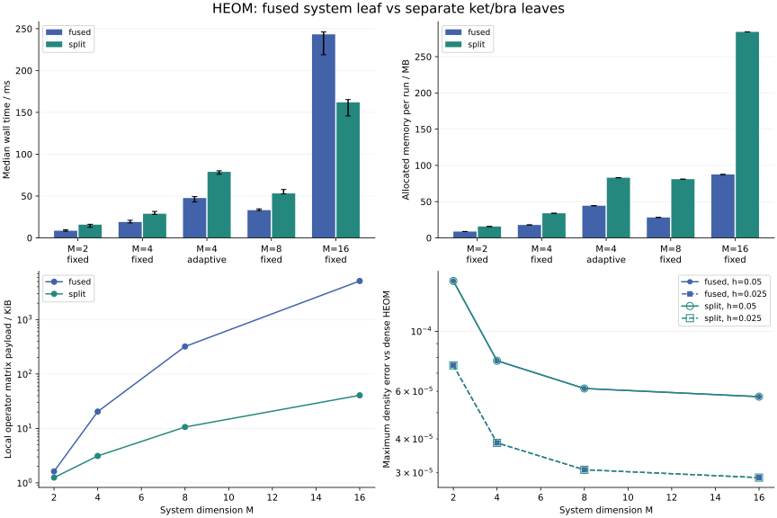
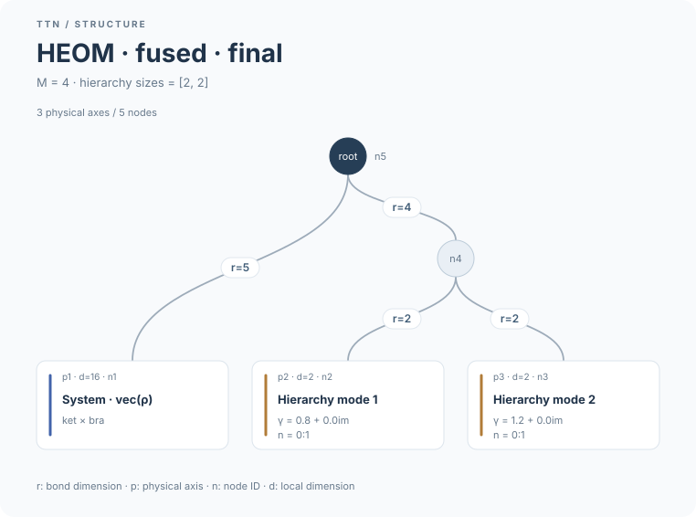
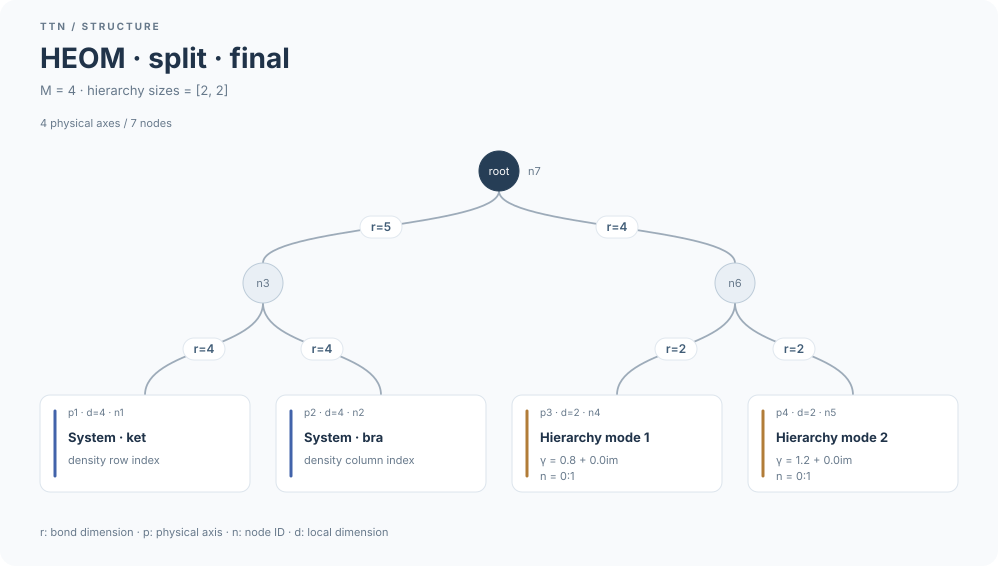

# Fused and split HEOM system layouts

Select the representation on the model; all constructors, observables and fixed/adaptive evolution then use that layout:

```julia
system = HEOMTTNSystem(H, modes, hierarchy_sizes; system_layout=:split)
initial = heom_initial_state(system, rho)
result = heom_evolve(system, initial, 0:0.05:1; atol=1e-10)
```

`:fused` is the compatible default, with dimensions `[M^2, sizes...]`. `:split` uses `[M, M, sizes...]`, ket first. Both flatten to the same column-major HEOM vector. In the default split tree, ket and bra are siblings; their parent connects to a balanced hierarchy subtree. Custom trees are supported too.

The split generator uses H/V on ket and transpose(H/V) on bra, avoiding M²-by-M² local factors. The number of product terms grows from 1+3K to 2+5K for K bath modes. The trace functional has rank M on both system leaves, so the current trace-protected algorithm keeps those ranks at M and requires `maxrank >= M`, even with `correct_trace=false`.

## Timing and storage

5 pairs run in alternating order after two complete warmups per layout. Julia and BLAS each use one thread. GC is enabled and explicitly collected before each timed call. This measures end-to-end `heom_evolve`, including generator and trace-functional construction, preparation, propagation and observations; model/initial-state construction, dense reference work and plotting are outside timing. No other test or numerical job ran concurrently. Reported times are medians; plot error bars show min–max.

The fixture uses a complex Hermitian tridiagonal H, two Hermitian coupling operators and two exponential modes with box sizes `[2,2]`. H has diagonal −0.2…0.2 and upper off-diagonal 0.25+0.07i. V has diagonal 0.6…1.2 and upper off-diagonal 0.1i; W has diagonal −0.3…0.7 and off-diagonal 0.07. Rates are 0.8 and 1.2, forward coefficients 0.05+0.01i and 0.025+0.005i, with conjugate backward coefficients and default scaling. The initial density is 0.95|1><1| + 0.05I/M.

All runs cover t=0–1 with `maxrank=64` and `correct_trace=false`. Fixed stepping uses h=0.05 and truncation atol=1e-10; h=0.025 is checked separately outside timing. The M=4 adaptive check uses initial dt=0.1, saveat=0:0.1:1, atol=1e-8, rtol=1e-4 and the default truncation fraction 0.1.

| M | Method | Fused, ms | Split, ms | Fused / split time | Fused / split allocated MB |
|---:|---|---:|---:|---:|---:|
| 2 | fixed | 8.55 | 15.80 | 0.54× | 8.77 / 15.65 |
| 4 | fixed | 18.96 | 28.81 | 0.66× | 17.85 / 33.93 |
| 4 | adaptive | 47.62 | 78.94 | 0.60× | 44.39 / 83.00 |
| 8 | fixed | 33.15 | 53.12 | 0.62× | 28.20 / 81.01 |
| 16 | fixed | 243.27 | 161.98 | 1.50× | 87.47 / 284.21 |

Ratios greater than one mean split is faster. Allocations are cumulative bytes, not peak resident memory. Local-operator storage below counts matrix payload only, excluding dictionary/object overhead and transient construction arrays. Ranks are maxima over saved states; augmented ranks and unsaved adaptive internal/rejected states are excluded.

| M | Fused / split operator KiB | Fused / split max saved rank | Fused / split max system–bath rank |
|---:|---:|---:|---:|
| 2 | 1.62 / 1.25 | 4 / 4 | 4 / 4 |
| 4 | 20.38 / 3.12 | 5 / 5 | 5 / 5 |
| 8 | 320.38 / 10.62 | 5 / 8 | 5 / 5 |
| 16 | 5120.38 / 40.62 | 5 / 16 | 5 / 5 |



For this fixture, the tradeoff is between extra split nodes/terms and smaller local matrix products. Split allocates more cumulative memory in every measured case, despite storing smaller operator matrices; this benchmark does not establish lower peak memory use. The crossover is specific to these models and this machine; it is not a general M threshold. Larger hierarchy ranks or different topologies can change the result. Fused remains the default.

## Accuracy

The dense reference applies the direct ADO equations without calling the product-sum generator. Matrix exponentiation at dt=0.025 supplies the reference trajectory, with global dimensions 16, 64, 256 and 1024. This validates the same finite box cutoff, not physical hierarchy convergence.

| M | Layout | Generator relative error | Max density error, h → h/2 | Final full-state relative error, h → h/2 |
|---:|---|---:|---:|---:|
| 2 | fused | 0.00e+00 | 1.535e-04 → 7.480e-05 | 7.385e-04 → 3.594e-04 |
| 2 | split | 1.18e-17 | 1.535e-04 → 7.480e-05 | 7.385e-04 → 3.594e-04 |
| 4 | fused | 0.00e+00 | 7.780e-05 → 3.868e-05 | 7.265e-04 → 3.574e-04 |
| 4 | split | 1.11e-17 | 7.780e-05 → 3.868e-05 | 7.265e-04 → 3.574e-04 |
| 8 | fused | 0.00e+00 | 6.143e-05 → 3.075e-05 | 7.259e-04 → 3.582e-04 |
| 8 | split | 1.12e-17 | 6.143e-05 → 3.075e-05 | 7.259e-04 → 3.582e-04 |
| 16 | fused | 0.00e+00 | 5.730e-05 → 2.876e-05 | 7.263e-04 → 3.589e-04 |
| 16 | split | 1.47e-17 | 5.730e-05 → 2.876e-05 | 7.263e-04 → 3.589e-04 |

The layouts can have different truncation budgets per edge and different adaptive meshes. Equal local tolerances do not imply identical trajectories. The following comparisons use their common observation times; trace drift is measured with root correction disabled.

| M | Method | Max density difference between layouts | Fused / split accepted (rejected) | Max trace drift |
|---:|---|---:|---:|---:|
| 2 | fixed | 3.491e-15 | 20 (0) / 20 (0) | 3.33e-15 |
| 4 | fixed | 4.082e-15 | 20 (0) / 20 (0) | 4.77e-15 |
| 4 | adaptive | 1.384e-08 | 16 (4) / 16 (4) | 1.02e-14 |
| 8 | fixed | 2.582e-15 | 20 (0) / 20 (0) | 2.22e-15 |
| 16 | fixed | 4.429e-15 | 20 (0) / 20 (0) | 4.02e-14 |

M=4 adaptive maximum density errors are 4.301e-06 (fused) and 4.305e-06 (split); final full-state relative errors are 3.919e-05 and 3.921e-05, respectively.

## Tree diagrams

The M=4 final trees show actual saved ranks:





## Reproduce

From the package root:

```sh
OPENBLAS_NUM_THREADS=1 julia --startup-file=no --project=examples benchmarks/heom_layout/run.jl 5
python3 benchmarks/heom_layout/plot.py
```

[Raw timings](../benchmarks/heom_layout/data/runs.csv) and [convergence data](../benchmarks/heom_layout/data/convergence.csv) are saved alongside the scripts. Re-running replaces these outputs and this report.

```text
Measured: 2026-11-05T10:54:35.749
Julia: 1.12.6
CPU: AMD Ryzen Threadripper PRO 9985WX 64-Cores
Julia threads: 1
BLAS threads: 1
BLAS: LBTConfig([ILP64] libopenblas64_.so)
Repetitions: 5
KrylovKit: 0.10.4
model sha256: 5f88fa062266b3465987377b0dccc2e6aa667803a7be7829464c7cb251186caf
BUG sha256: 75ee9988755fb722574a829fccbedddbc3d0753328dca8eb760ba77f8656d984
workspaces sha256: 69b960c079be6fa97550c99ba5834f9fbb95c579b922df1ea3f7943156fc6051
```

Related density-vectorization work: R. Borrelli, “Density matrix dynamics in twin-formulation,” J. Chem. Phys. 150, 234102 (2019), [doi:10.1063/1.5099416](https://doi.org/10.1063/1.5099416).
