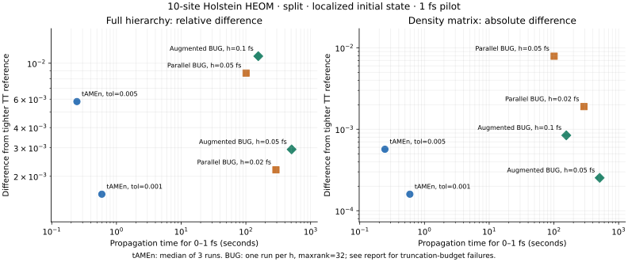
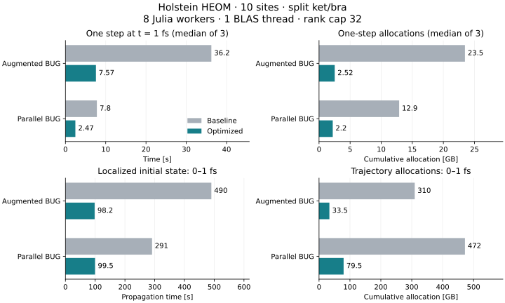
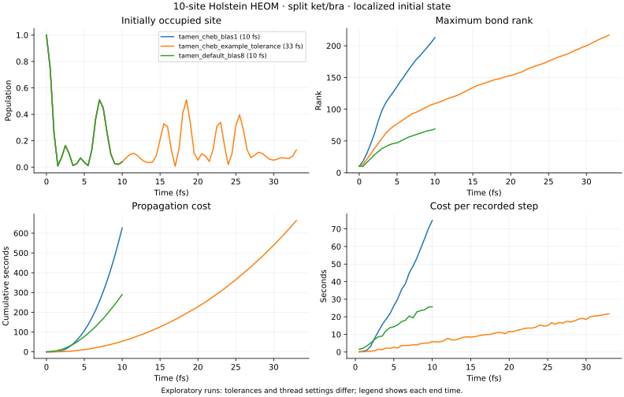

# 10サイトHolstein HEOM: splitでの途中計測

2026-11-05。ユーザー指定の**局在初期状態から100 fs**を目標にしたが、
最初の計測は追加指定の「計算時間をまず1時間程度に制限」に合わせて区切った。
以下には、その後のaugmented BUGの追試と縮約最適化も含める。
最新の変更前後比較は [BUG系の縮約最適化](#bug系の縮約最適化) にまとめた。
**100 fs全区間について精度を揃えた速度比は、まだ得られていない。**

## モデルと検証

[TTDynamicsのHolstein例](../../TTDynamics/examples/holstein)の現在の物理設定を使い、
サイト数を10、初期状態をサイト1の局在状態に変更した。元のconfig・出力は変更していない。

- 周期境界、hopping 4000、Brownian周波数160、damping 300、再配置エネルギー800 cm⁻¹、300 K。
- PSD order 0、各サイト2成分、階層の各局所サイズ5（n=0,…,4）。
- TTもTTNもket/braを分離。TTNは22葉・43ノード。全空間は100×5²⁰要素。
- HEOMKitの `NoiseExp.c1/c2` と `sqrt(abs_coeff)` をTTNにも使用した。
  複素共役極の対では `c2[k]` は一般に `conj(c1[k])` と異なる。
- 生成子をMPOで比較した相対Frobenius差は2.41×10⁻¹³。
  2サイト・階層局所サイズ2の密行列検証は9項目通過。

## 最適化前の0–1 fs比較

以下は同じ局在初期状態から1 fsまでの伝播時間。
コンパイル、モデル構築、観測・保存は計時から除外した。
CPUはThreadripper PRO 9985WX、Julia 1.12.6。tAMEnはBLAS 8 threads、
BUGはJulia 8 workers・BLAS 1 thread、Stridedは1 thread。
共用マシンでの測定であり、tAMEnは3回の中央値、BUGは各1回。
BUGの0.02 fs計算は保存状態から再開し、両区間の伝播時間を合計した。再コンパイルは除外。

| 方法・設定 | 時間 [s] | 最大ランク | 全階層の相対差 | 密度行列の差（Frobenius） |
|---|---:|---:|---:|---:|
| tAMEn Chebyshev12、tol=5×10⁻³ | 0.245 | 20 | 5.79×10⁻³ | 5.68×10⁻⁴ |
| tAMEn Chebyshev12、tol=10⁻³ | 0.595 | 31 | 1.55×10⁻³ | 1.60×10⁻⁴ |
| parallel BUG、h=0.05 fs | 100.76 | 32 | 8.69×10⁻³ | 7.88×10⁻³ |
| parallel BUG、h=0.02 fs | 291.38 | 32 | 2.19×10⁻³ | 1.90×10⁻³ |
| augmented BUG、h=0.1 fs | 155.45 | 32 | 1.11×10⁻² | 8.42×10⁻⁴ |
| augmented BUG、h=0.05 fs | 509.11 | 32 | 2.93×10⁻³ | 2.53×10⁻⁴ |

tAMEnの外側の刻み幅は0.5 fs。tol=5×10⁻³では3 sweeps・local iterations 5、
tol=10⁻³では5 sweeps・local iterations 10を使用した。両方とも内部採用区間数は合計2。
BUGのランク上限は32、各ステップの切断許容誤差は `1e-3*h`。
切断予算はparallelのh=0.05で15/20ステップ、h=0.02で44/50ステップにおいて未達だった。
augmentedはh=0.1で5/10ステップ、h=0.05で15/20ステップが未達。
この診断は保守的な切断誤差上界に基づき、表の参照状態との差とは別の量である。

差はChebyshev12、tol=10⁻⁵、20 sweeps・local iterations 20、h=0.5 fsのTT参照に対するもの。
全階層は圧縮形式の縮約で比較し、密テンソルには展開していない。
参照をtol=10⁻⁶へ厳しくしたとき、1 fsでの全階層相対差は3.69×10⁻⁵、
密度行列の差は1.66×10⁻⁶だった。表の比較対象の差より小さいことを確認した。
これは0–1 fsの参照安定性の確認であり、厳密解に対する誤差保証ではない。

全階層の相対差が10⁻³台の2設定を比べると、tAMEnは約490倍短時間だった。
ただし、厳密に同じ誤差へ調整した最適速度比ではない。密度行列の差はtAMEnの方が小さく、
BUG側にはランク上限による未解決の切断誤差もある。
**この結果から100 fsや、発達した高ランク状態での速度比を推定することはできない。**

augmentedのh=0.05とparallelのh=0.02を比べると、試した設定ではaugmentedが
約1.75倍の時間を要した。全階層の相対差は2.93×10⁻³対2.19×10⁻³で、
密度行列の差はaugmentedの方が約7.5倍小さい。比較する誤差指標を分けて読む必要がある。
tAMEnのtol=10⁻³に対しては約856倍の時間で、全階層の相対差は約1.89倍大きい。
したがって、これは「相対差が数×10⁻³の試行」の比較であり、10⁻³以下の誤差や
厳密に同一の誤差を達成した比較ではない。

augmentedのh=0.1は155秒で密度行列の差8.42×10⁻⁴だが、全階層の差は1.11×10⁻²。
密度行列だけを判定基準にする場合と、全階層状態も必要な場合では採用設定が変わる。
augmentedのh=0.05ではGC時間が92.3秒（約18%）、累積割当量が309.6 GBだった。
これはピークメモリ使用量ではない。拡張基底上の局所計算に加え、割当削減にも改善余地がある。



## 遅さの切り分け

上の約856倍という値には、最適化前の実装で重複していた計算も含まれる。
tAMEn側は圧縮したMPOを使う一方、BUGの局所作用ではSoPの102項を個別に処理していた。
この時間比を、BUG法そのものの性能差として一般化することはできない。

augmentedのh=0.05で得た1 fsの保存状態から、同じhで1ステップを計測した。
隔離したソースコピーにタイマーを挿入し、本体の出力との距離6.43×10⁻¹⁶を確認した。

| 部分 | 時間 [s] |
|---|---:|
| 準備・古い基底の環境縮約 | 1.81 |
| 再帰的な局所更新・新しい基底の環境縮約 | 32.42 |
| 切断など | 0.76 |
| 全体 | 34.99 |

この1ステップで累積23.47 GBを割り当て、GCに6.88秒かかっていた。
上位の大きいノードでは、ランク32から拡張したランク64の空間を扱う。
各ノードの局所指数作用は最大11.7秒で、兄弟の処理後に親の処理が続くため、
8 workersが常時有効に働くわけではない。
Profileの待機を含む全スレッドサンプルではutilizationが約20%だった。
これはOSで測ったCPU使用率ではなく、プロファイラの集計値である。

診断用の別実装で、局所作用の3因子のうち2因子が完全一致する項をまとめた。
たとえば `B ⊗ L₁ ⊗ R + B ⊗ L₂ ⊗ R = B ⊗ (L₁+L₂) ⊗ R` を使う。
比較許容誤差による近似や新たなランク切断は行っていない。
102項はノードに応じて7–32項となり、大きい内部ノードでは15または23項になった。

| 同じ保存状態からの1ステップ | 時間 [s] | 累積割当量 [GB] | 元の出力との相対差 |
|---|---:|---:|---:|
| 最適化前の本体 | 35.38 | 23.47 | — |
| 項をまとめた検証実装 | 12.92 | 23.48 | 7.23×10⁻¹⁶ |

状態を保ったまま約2.74倍速くなることを確認した。密度行列の差は2.18×10⁻¹⁶。
複素・非Hermitianな小さい局所演算子について、独立に組み立てたKronecker積との
一致や入力・出力の独立性を7項目で検証した。

割当量は依然として大きく、項ごとの環境縮約における重複計算と作業配列の再利用が
次の調査・最適化対象となる。また、1 fs時点の保存要素数はTTNが214,288、
比較用のtol=10⁻³のTT軌道が49,900で、近い最大ランクでも局所問題の大きさは異なる。
この初期検証の時点では、コードをbenchmark内に隔離し、本体には未反映だった。
その後、項の集約に環境縮約・作業配列の再利用を加えて本体へ反映した（下記）。
0–1 fs全体の時間や100 fsの時間に、この1ステップの改善率をそのまま適用することはできない。

## BUG系の縮約最適化

局在初期状態から0–1 fsまで、変更前後を同じ刻み幅・切断条件で完走させた。
augmentedはh=0.05、parallelはh=0.02、ランク上限32。各1試行の伝播時間で、
warm-up・観測・保存は含めない。

| 手法 | 伝播時間：変更前 → 最終版 [s] | 高速化 | 累積割当量：変更前 → 最終版 [GB] | 最終状態の相対差 |
|---|---:|---:|---:|---:|
| augmented | 490.40 → 98.15 | 5.00倍 | 309.65 → 33.48 | 3.93×10⁻¹¹ |
| parallel | 291.12 → 99.51 | 2.93倍 | 472.14 → 79.52 | 3.62×10⁻⁸ |

TT参照に対する全階層相対差は、変更前後ともaugmentedが2.93×10⁻³、parallelが2.19×10⁻³。
密度行列の参照との差もそれぞれ2.53×10⁻⁴、1.90×10⁻³で、表示桁では変化しなかった。
保存した最終状態を読み直した変更前後の密度行列差は、augmented 3.61×10⁻¹⁴、
parallel 1.00×10⁻¹⁰（Frobeniusノルム）。`final_state_check.csv` に記録した。
切断予算未達は15/20、44/50ステップで変化していない。
多ステップでは状態差が単ステップより大きくなるが、今回の参照誤差より十分小さい。
ランク上限の収束や100 fsの精度を、この比較で保証するものではない。



augmented / parallelの共有カーネルに、以下を実装した。

- 2因子が完全一致する局所演算子項を集約。parallelの矩形cross blockにも適用する。
- 葉・部分木・補空間・mixed環境で同一の縮約入力を検出し、同じノード内で結果を共有する。
- 大きい中間テンソルをノードごとの作業配列に確保し、異なる項の縮約にも再利用する。
- 固定入力の軸並べ替えをループ外へ移し、途中の余分な並べ替えを省く。

キャッシュは呼出し内だけで有効であり、更新前の状態から次のステップへ使い回さない。
共有した環境行列は読み取り専用。Krylovの作用結果と異なる環境の出力は独立した配列である。
時間刻み、局所Krylov許容誤差、切断許容誤差、ランク上限、トレース保護は変更していない。

最終版の段階別プロファイルでは、準備0.65秒、局所更新など5.91秒、切断など0.69秒、
全体7.25秒だった。累積割当量2.52 GB、GC時間1.29秒。
これは単体のプロファイル計測で、変更前との通常計時による反復比較とは分けて扱う。

共通因子のないランク2/8/16・2/32項の小さい局所問題でも計測した。
単発のparallel blockでは集約の準備により約1.4–2.7倍遅い例があり、
絶対時間の増加は約1 µs–0.46 msだった。すべての演算子・サイズで速くなる変更ではない。
詳細は `data/optimization_unstructured.csv`。局所作用を10回使う場合の準備込み時間も記録した。

変更前のソースは `data/optimization_baseline/` に保存し、測定時だけ別モジュールへ読み込む。
1 fsの同じ保存状態から、8 Julia workers・BLAS 1 threadでwarm-up後に各3回計時する。
順序は試行ごとに入れ替え、最終計測中は開発用のテストを並行実行しなかった。
以下は各3試行の中央値。augmentedはh=0.05、parallelはh=0.02、ランク上限32。

| 手法 | 変更前 [s] | 項の集約のみ [s] | 最終版 [s] | 変更前/最終版 | 累積割当量：変更前 → 最終版 [GB] |
|---|---:|---:|---:|---:|---:|
| augmented | 36.22 | 14.31 | 7.57 | 4.78倍 | 23.47 → 2.52 |
| parallel | 7.80 | 6.03 | 2.47 | 3.16倍 | 12.89 → 2.20 |

変更前の出力に対する状態の相対差は、augmented 7.23×10⁻¹⁶、parallel 1.05×10⁻¹⁵。
割当量は累積値であり、ピークメモリ使用量ではない。
両手法に同じaugmented由来の保存状態を入力した局所比較であり、
それぞれの実際の軌道全体の速度比とは区別する。

100 fs全区間の収束比較は引き続き未完了である。

検証はTTNSolver 729項目（1 workerと8 workers）、TTNDynamics 421項目（8 workers）が通過。
新規テストでは複素・非Hermitian・矩形の作用を独立なKronecker積と照合し、
近いが一致しない因子、ゼロ・相殺、入力と出力の所有権、変更後の入力からの再計算を確認した。
ランク20・異なる12項の環境縮約で10.84 MBだった割当量が2 MB未満となる回帰テストも追加した。

## 長時間側で確認できたこと

元のCN3設定は10 fsまでで289.7秒、最大ランク69。
外側の0.5 fsごとに、内部で約33区間へ分割されていた。
より厳しいChebyshev tol=10⁻³の予備軌道は10 fsで最大ランク213に達した。
8 fsの状態を10⁻⁶以下の相対許容誤差で再圧縮しても、最大ランク184は下がらなかった。

元の許容誤差5×10⁻³を使ったChebyshev設定は**33 fsまで**進めた。
伝播時間664.0秒、最大ランク217。33 fsでトレースのずれは2.22×10⁻¹²、
Hermiticityのずれ `norm(ρ-ρ')` は約0.0111だった。
高ランクになることは確認できたが、この領域のTTN軌道と100 fsの収束比較は未完了。



## 再実行とデータ

コード・CSV・図は [benchmarks/holstein10_split](../benchmarks/holstein10_split) にある。
状態の大きい `.jls` はgit対象外。各trajectoryのmetadataには設定とソースのSHA256を保存した。
短時間比較は `data/short_tamen.csv` と `data/calibration.csv`、長時間側は各runの `steps.csv`。
augmentedは `data/augmented_h01/summary.csv` と `data/augmented_h005/summary.csv`。
参照の追加確認は `data/reference_check.csv` にある。
段階別プロファイルは `data/profile_augmented/`、項をまとめた検証実装との比較は
`data/grouped_probe/` に保存した。
本体の最適化後は `data/optimized_steps_final_augmented/`、
`data/optimized_steps_final_parallel/`、`data/profile_optimized/` にある。
0–1 fsの変更前後の軌道は `data/optimized_trajectories/` に保存した。

```bash
cd TTNDynamics/benchmarks/holstein10_split
bash run.sh verify.jl
# augmentedの0–1 fs追試（新しいラベルを使う）
bash run.sh bug_case.jl new_augmented augmented 0.05 32
# 新しいラベルで100 fs計算を開始する例
bash run.sh trajectory.jl new_tamen tamen 0.5 0.005 128 cheb 12 3 5 8 100
bash run.sh trajectory.jl new_parallel parallel 0.02 0.00002 32 CN 3 3 5 1 100
```

後者は今回の測定設定の再現であり、十分なランク・精度が確認済みの設定ではない。
次の計測ではBUGのランク上限と刻み幅を別々に収束確認する必要がある。
`evaluate.jl` と `compare_observables.py` は、既定で100 fsまでの必要な時刻が
揃っていない比較を拒否する。部分比較には明示的な指定が必要。
