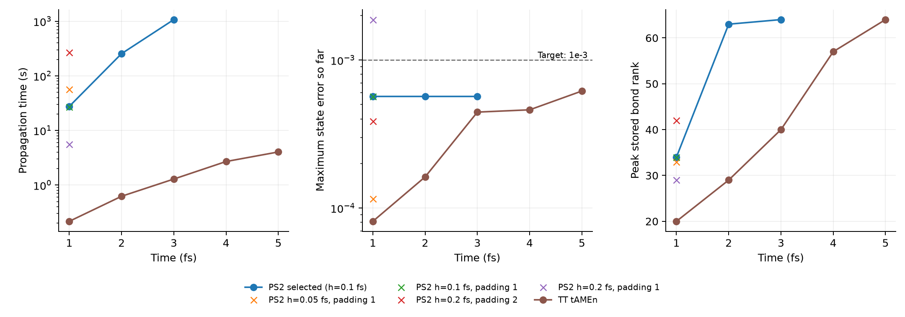

# ランク適応PS2のHolstein試行

この測定後、往復の折返しで相殺するroot更新3回を省略した。
[変更内容と検証](reference_optimization.md)を参照。以下の長時間測定は変更前の結果。

今回の10サイトHolsteinでは、PS2もTT tAMEnより大幅に遅かった。
共通の3fsまでで両方が誤差目標1e-3を満たし、PS2は1069.198秒、TTは1.288秒だった。
約1時間の計算枠でPS2は3.8fsまで進み、5fsは未完了。精度比較は保存時刻の3fsまでとする。

隣接2コアを更新するTDVP／projector-splitting法を、比較用の
[PS2モジュール](../benchmarks/holstein_ps2/ps2.jl)として実装した。
Chen–Francoの[TTN-HEOM論文](https://doi.org/10.1063/5.0278591)、
Algorithms4–6の対称往復スイープに基づく。既定の積分器や公開APIには追加していない。

## 実装と制約

- 木の直交中心を移動し、変更された側の演算子環境を更新する。
  局所作用は積和形式で、同一因子の組をまとめ、作業領域を再利用する。
- 局所線形方程式には非エルミートArnoldiによる指数作用を使う。
  正負の部分ステップを含み、半ステップの往復を対称に組み合わせる。
- 2コアの分割時にSVDで内部結合のランクを決める。物理葉の基底は全次元を保持する。
  `rank_padding=2` は必要と判断したランクに余分な方向を保持する試行設定、
  `1` は余分な保持を行わない設定。初期の低ランク空間に閉じ込められる可能性があるため、
  いずれも参照解との比較で検証する。
- トレース汎関数の方向をQR移動とSVD切断で保護する。事後のトレース補正はしない。
  保護付きQRで一時ランクが上限を超えた場合は、ステップ終端の保護付き圧縮で上限を戻す。
  切断予算の半分はこの処理用に確保する。
- 局所切断尾部のノルム和を記録するが、その後の非ユニタリ発展による増幅を含まないため、
  時間発展全体の誤差上界とは呼ばない。今回のPS2は木のスイープ自体は逐次実行し、
  行列演算にBLAS8スレッドを使う。

TTNOへの演算子圧縮は未実装。tAMEnの時空間残差構築は行わないが、
局所作用で積和項を縮約するコストと2コアを結合するコストは残る。
逆向き部分ステップの安定性も、この試行を他のHEOM設定へ拡張する際の検証対象となる。

## 数値検証

一般の複素・非エルミート小系で密な行列指数との一致、非標準の木・葉順、
ゼロ状態、入力非破壊、保存量、ランク増加、上限での切断、Arnoldi失敗の伝播を確認した。
早期収束判定の有無でも解が一致し、作用回数が減ることをテストする。
一般テスト40件、2サイトHEOM75件、比較ランナー8件が通過した。

2サイトsplit HEOM、浴局所次元2、1fsまでの全階層状態の相対誤差：

| 刻み幅 | 密な行列指数との差 |
|---|---:|
| 0.2 fs | 5.58e-5 |
| 0.1 fs | 1.40e-5 |
| 0.05 fs | 3.49e-6 |

この試験では刻み半減で約4分の1の誤差になった。任意のランク上限・切断許容誤差でも
二次収束するという主張ではない。独立レビューでスイープ順序・複素共役・環境更新を
確認し、TT比較側のコピー処理と実行条件・参照ラッパーの記録を修正した。

## 10サイトの比較条件

[前回](holstein_ttn_tamen.md)と同じ周期Holstein模型：split、局在初期状態、
飛び移り400、Brownian周波数800、減衰300、再配置エネルギー800cm⁻¹、300K、
Padé次数0、浴指数ごとの局所次元5。物理的な浴・階層近似の収束ではなく、
この固定した模型に対する積分精度と時間を比較する。
木は系のket/bra枝とbalancedな浴部分木を持つ22葉・43ノードで、前回と同じ構造を使う。

PS2は最大保存ランク64、局所Arnoldi許容誤差1e-12、最大Krylov次元30、
ステップ切断予算1e-5×h。`eager=true` で基底追加ごとに収束を判定する。
最初の `eager=false` 試行は0.4fsまでを保存して停止した。約5,200回／ステップの
局所作用が発生したため、同じ許容誤差で早期判定する設定を別の出力先で試した。
旧結果とソースは `output/holstein5` に保持する。

1fsで刻み幅と追加基底保持量を校正し、精度目標と切断予算を満たした最速候補を5fsへ延ばす。
TT tAMEnも5fsを3回再計測する。精密参照は前回の2条件を再利用し、模型・ソース・
実行環境・ラッパー・保存状態のハッシュを確認する。参照同士の5fsまでの最大差は
全階層状態1.78e-5、密度行列2.56e-6。

毎1fsの保存状態で、精密参照に対する相対状態誤差と絶対密度行列誤差がともに1e-3以下なら
精度目標達成とする。伝播時間は初期化・ウォームアップ・保存・精度検証を除き、GCを含む。
未完の軌道は、完了・検証した共通時刻までしか比較しない。

## 1 fsでの校正

2026-11-06、Julia1.12.6、Threadripper PRO9985WX、Julia4・BLAS8スレッド。
TTは3回の中央値、PS2各設定は1回の測定。両者が同じ精度目標を満たすことを基準にし、
誤差の値そのものが等しいとは扱わない。

| 手法・設定 | 伝播時間 | 状態誤差 | 密度行列誤差 | 最大保存ランク | 精度目標 |
|---|---:|---:|---:|---:|---|
| TT tAMEn | 0.217秒 | 8.14e-5 | 8.90e-6 | 20 | 達成 |
| PS2、h=0.2fs、padding1 | 5.625秒 | 1.88e-3 | 2.91e-4 | 29 | 未達 |
| PS2、h=0.1fs、padding1 | 27.072秒 | 5.68e-4 | 8.33e-5 | 34 | 達成 |
| PS2、h=0.05fs、padding1 | 56.469秒 | 1.16e-4 | 2.21e-5 | 33 | 達成 |
| PS2、h=0.2fs、padding2 | 266.324秒 | 3.85e-4 | 8.39e-5 | 42 | 達成 |

全PS2設定で局所切断予算を満たし、トレース誤差は8.44e-15以下だった。
ただし局所切断予算だけでは、時間離散化や初期基底に由来する誤差を制御できない。
最速の5.625秒という値は精度目標を満たさず、採用できない。
精度目標を満たした最速設定は0.1fs・padding1で、TTの約125倍の時間を要した。
TTの1fs計測は0.110〜0.222秒とばらつくが、この差を逆転する幅ではない。

0.1fs・padding1の27.072秒のうち、局所指数作用23.790秒（87.9%）、
環境構築2.549秒、QR/SVDなどの分割0.665秒だった。
43ノードの木では1ステップ169回の局所指数作用を行う。
padding2は局所ベクトルの最大要素数が285万まで増えた。保存時の結合ランクだけでは
この中間コストを説明できない。追加基底は精度改善に効いたが、今回の速度には不利だった。

5fs試行には、精度目標と切断予算を満たす最速の0.1fs・padding1を選んだ。

## 継続試行の結果

| 手法 | 共通範囲 | 伝播時間 | 最大状態誤差 | 最大密度行列誤差 | 最大保存ランク |
|---|---:|---:|---:|---:|---:|
| TT tAMEn | 0–3 fs | 1.288秒 | 4.45e-4 | 4.01e-5 | 40 |
| PS2、h=0.1fs、padding1 | 0–3 fs | 1069.198秒 | 5.68e-4 | 2.17e-4 | 64 |

共通目標を満たす範囲でPS2は約830倍遅い。TTの3回の範囲は0.884〜1.312秒で、
誤差は3回とも同じだった。CPU割り当てを固定した並列効率測定ではない。
PS2の最大トレース誤差は1.12e-14未満。局所切断予算は全ステップで満たした。
状態誤差・密度行列誤差は毎1fsの点で検証した値で、区間内の連続した誤差保証ではない。

PS2は3.8fsまで38ステップ、伝播時間2276.825秒でソフト時間上限に達し、
正常にチェックポイントを保存して終了した。3.8fsの精密参照比較は実施していない。
比較・解析バッチ自体は終了コード0で完了し、軌道の状態は `timeout` と記録した。
TTは5fsまで完了し、中央値4.036秒、最大状態誤差6.18e-4、密度行列誤差1.21e-4だった。
PS2の3fsまたは3.8fsの時間をTTの5fsの時間で割った速度比は使わない。

3fsまでのPS2の内訳は次のとおり。

| 処理 | 時間 | 伝播時間に占める割合 |
|---|---:|---:|
| 局所指数作用 | 977.569秒 | 91.4% |
| 環境構築 | 66.645秒 | 6.2% |
| QR/SVDなどの分割 | 22.896秒 | 2.1% |
| その他 | 2.088秒 | 0.2% |

GC79.160秒は各処理の時間に含まれるため、表に加算しない。
累積確保量はPS2が188.384GB、TTが0.346GB。これらはピーク使用量ではない。
PS2は3fsまでに5070回の局所指数作用、32393回の演算子作用を行い、
最大局所ベクトルは227万要素だった。3.8fsまで延ばすと403万要素になった。

TTN tAMEnで支配的だった大域残差の構築をなくしても、今回のPS2では2コアを結合する
局所更新が重い。SVDだけを最適化しても効果は限られる。次の性能検討は、
積和演算子を圧縮したTTNOによる局所作用や、2コア全体を展開しない更新の評価が候補になる。
この試行だけでTTNやPS2一般の性能を結論づけず、現在の実装・模型・精度条件の結果とする。

PS2選定設定の線は、精度を検証できた3fsで止めている。1fsだけの点は校正設定。

## 再現とデータ

[実行手順](../benchmarks/holstein_ps2/README.md)、
[計測ログ](../benchmarks/holstein_ps2/output/batch_eager.log)。
結果は `benchmarks/holstein_ps2/output/holstein5_eager` 以下に保存する。

- [時間・誤差・ランクの集計](../benchmarks/holstein_ps2/output/holstein5_eager/summary.csv)
- [各反復・各保存時刻の検証](../benchmarks/holstein_ps2/output/holstein5_eager/comparison.csv)
- [処理別の計時](../benchmarks/holstein_ps2/output/holstein5_eager/phase_summary.csv)
- [実行の完了・打ち切り状態](../benchmarks/holstein_ps2/output/holstein5_eager/run_status.csv)
