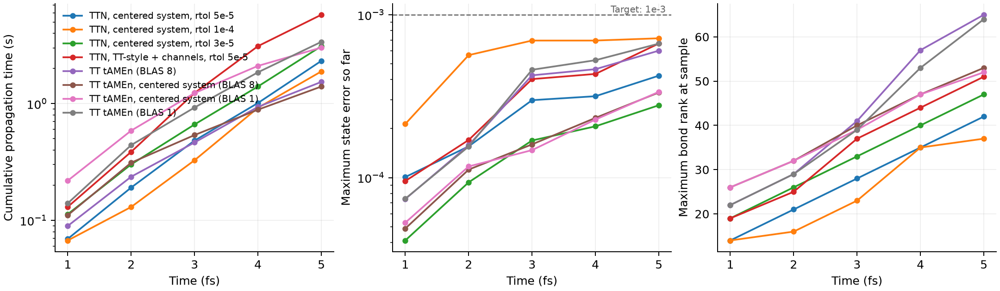

# Holstein：GCの検討と、系を浴の中央に置く木（5 fs）

[TT流の受理条件とチャネル環境](holstein_tt_acceptance.md)に続く検討。対象は同じ10サイト周期Holstein模型
（split、局在初期状態、5 fs）で、TTNの設定はチャネル版（`rtol=5e-5`、切断1e-5、局所許容誤差1%）である。

**要約**

- **GC。** 計算中のGCを止めても、5 fsでの短縮は約14%が上限だった。確保を減らす変更（後述）で約3〜5%短縮した。残りの確保の多くはKrylovKitの基底と出力ベクトルで、現在の設計では避けにくい。
- **木構造。** 浴の結合グループを前半と後半に分け、系をその間に置く木 `(前半, (系, 後半))` が最も速かった。同じバッチ内で、5 fsまでの時間は従来の木の5.77秒から2.33秒になった（2.5倍）。
- **TTとの比較。** 1コア同士ではTTNとTTはほぼ同等である。複数コアを使うと、TT（BLAS8）がTTN（Julia 4スレッド）より約1.5〜1.7倍速い。以前のバッチの時間比は背景負荷の影響を受けていた（下記）。

## GCの検討

5 fsの全軌道を、GCを有効のまま、計算中だけ無効、GCスレッド4の3条件で、3回ずつ測った。

| 条件 | 5 fs時間 |
|---|---:|
| GCスレッド1（ベンチマークの既定） | 6.97〜7.65秒 |
| 計算中はGCを無効（上限の目安） | 5.90〜6.68秒 |
| GCスレッド4 | 6.35〜6.93秒 |

確保の内訳（最終区間、サンプリング）は広く分散していた。最大のものは次のとおりである。
- KrylovKit内部の基底と、行列ベクトル積の出力（約15%）
- 切断の複製と再直交化（約20%）
- 形状が変わるたびの作業バッファの再確保
- 時間誤差推定

次を実施した（TTNSolver `d258229`）。
- 作業バッファを、ノードごとに直近3形状まで保持する。
- Chebyshev法の時間誤差推定で、最後の根の解法の環境を再利用する。
- Chebyshev法の単位行列 `M` を、空間項の明示的な時間因子として付けない（同じ演算子）。

コミット済みの版と交互に比べた結果、確保は4.86 GB→4.72 GB、時間は約5%短縮し、誤差は一致した。
GCスレッド数はTTと共通のベンチマーク条件なので変えていない。

## 木構造の探索

同じ設定で木だけを変え、5 fsまで1回ずつ走らせた（Julia 4スレッド、BLAS1）。
全状態誤差は、木の葉の訪問順と同じモード順のTT参照で求めた（後述）。
順序が合う参照を用意していない木は、密度行列誤差だけを示す。

| 木 | 構造 | 5 fs時間 | 最大ランク | パラメータ数 | 全状態誤差 | 密度行列誤差 |
|---|---|---:|---:|---:|---:|---:|
| balanced（従来） | 根＝(系, 浴20モードのつり合い木) | 7.15秒 | 51 | 20.4万 | 6.7e-4 | 9.9e-5 |
| coupling | 同上、サイトの2モードを兄弟に | 7.72秒 | 51 | 20.4万 | 6.3e-4 | 9.1e-5 |
| caterpillar_tt | TTと同じ鎖（系が端） | 12.71秒 | 62 | 22.5万 | 6.7e-4 | 1.4e-4 |
| comb_sites | 鎖の各歯にサイト対 | 12.63秒 | 62 | 27.6万 | 6.5e-4 | 1.5e-4 |
| ket_root | 根＝(ket, (bra, 浴)) | 9.14秒 | 56 | 28.2万 | 5.9e-4 | 1.1e-4 |
| ring_pairs | サイトを初期励起からの環上の距離順に | 6.03秒 | 51 | 18.7万 | — | 8.1e-5 |
| caterpillar_mid | 鎖の中央に系 | 4.59秒 | 42 | 16.8万 | 4.0e-4 | 9.6e-5 |
| system_center_flip | ((前半, 系), 後半) | 3.51秒 | 42 | 14.3万 | 3.6e-4 | 9.6e-5 |
| **system_center** | **(前半, (系, 後半))**、サイト対でまとめる | **2.42秒** | 42 | 13.5万 | 4.2e-4 | 1.0e-4 |
| system_center_modes | 同上、モード単位でつり合い | 2.37秒 | 42 | 13.6万 | 4.7e-4 | 1.1e-4 |
| system_center_chains | 同上、半分を鎖に | 2.38秒 | 42 | 13.5万 | 4.1e-4 | 9.6e-5 |
| system_center_quad | 同上、四分割のつり合い | 2.04秒 | 42 | 12.1万 | 3.6e-4 | 9.9e-5 |

caterpillar_tt、comb_sites、ket_root、ring_pairsの4つは、同じ条件の最初の探索で測った値である。
従来の木では、根の直下で浴全体を束ねるノードが3本の太い結合（51,51,38）を持つ。
系を中央に置くと、系と強く相関する2つの浴の半分を1つのノードで直接束ねずに済み、最大のコアが（42,42,32）に縮む。
ring_pairsは初期条件に依存する並べ方なので、採用候補から外した。system_center系の各変形の差は、1回の測定の揺らぎと区別できない。
そのため、最も単純な system_center を `heom_tree` に実装した。

```julia
tree = heom_tree(system; bath_grouping=:coupling, system_position=:center)
x = heom_initial_state(system, rho; tree)
```

既定値は従来どおり `system_position=:root` である。物理軸の順序は変えず、木の形だけが変わる。
結合グループが1つしかない場合は従来の配置になる。

## TTも系を中央に置く

TTNの木だけを変えた比較にならないよう、TT tAMEnのモード順も同じ順序（浴：サイト1〜5、ket、bra、浴：サイト6〜10）にした。
積和演算子のモード番号を並べ替えてMPOに変換すると、MPOの最大ランクは20から12に下がった。
TTの5 fsの全状態誤差も、同じ設定で6.0e-4から3.3e-4に下がった。この順序のTT参照解は、全状態誤差の検証にも使う。

## 正式な測定（`output/tree_center`）

ソースを凍結し、実行前後でハッシュの一致を確認した。3回の中央値（最小–最大）である。
各ケースは、同じモード順の参照・精密参照と比べた。参照どうしの5 fsまでの最大差は次のとおりで、基準1e-4を満たす。
- 元の順序：全状態1.8e-5、密度行列2.6e-6
- 中央の順序：全状態8.9e-6、密度行列6.4e-7

| 手法 | 5 fs時間 | 全状態誤差 | 密度行列誤差 | 最大ランク |
|---|---:|---:|---:|---:|
| TT、元の順序、BLAS8 | 1.535秒（1.517–1.916） | 6.0e-4 | 1.3e-4 | 65 |
| TT、元の順序、BLAS1 | 3.383秒（3.343–3.385） | 6.7e-4 | 1.4e-4 | 64 |
| TT、中央の順序、BLAS8 | **1.401秒**（1.399–1.427） | 3.3e-4 | 5.0e-5 | 53 |
| TT、中央の順序、BLAS1 | 3.022秒（3.019–3.424） | 3.4e-4 | 4.9e-5 | 52 |
| TTN、従来の木（`tree_tt_channels`） | 5.773秒（5.761–6.245） | 6.7e-4 | 9.9e-5 | 51 |
| TTN、中央の木、rtol=5e-5 | **2.325秒**（2.313–2.327） | 4.2e-4 | 1.0e-4 | 42 |
| TTN、中央の木、rtol=3e-5 | 3.104秒（3.095–3.114） | 2.8e-4 | 6.0e-5 | 47 |
| TTN、中央の木、rtol=1e-4 | 1.888秒（1.881–1.898） | 7.2e-4 | 2.8e-4 | 37 |

TTNはJulia 4スレッド・BLAS1、TTはBLASスレッド数だけを変えた。
TTN（中央の木、rtol=5e-5）は、最速のTT（中央の順序、BLAS8）の1.66倍、元の順序のTT（BLAS8）の1.51倍の時間だった。1コアのTT（3.0〜3.4秒）よりは速い。
TTNの内訳は、ALS 1.94秒、環境構築0.15秒、時間誤差推定0.04秒、GC 0.47秒、行列ベクトル積3161回だった。

`tt_center_serial` は名前の判定の不具合で、バッチ内では実行されなかった。
同じ凍結ソース・同じハーネス・同じ実行条件（Julia 4スレッド、GCスレッド1）で設定を明示し、別のプロセスで追加実行した。
その後に集計し直している。判定は修正済みで、`verify.jl` でも確認している。

## 使うコア数を揃えた比較と、計時の揺らぎ

空いているマシン（負荷平均1〜4）で、5 fsを2回ずつ続けて測った。

| 構成 | 1 | 2 | 4 | 8 |
|---|---:|---:|---:|---:|
| TT、中央の順序（BLASスレッド数） | 3.37秒 | 2.37秒 | 2.1秒 | 2.08秒 |
| TT、元の順序（BLASスレッド数） | 3.90秒 | 2.85秒 | 2.3秒 | 2.0秒 |
| TTN、中央の木（Juliaスレッド数、BLAS1） | 3.02秒 | 3.13秒 | 3.02秒 | 2.77秒 |

1コア同士ではTTNとTTはほぼ同等である。TTはBLASのスレッドで4倍程度まで速くなる。
TTNは兄弟ノードの並列化でもBLASのスレッド（1スレッド・BLAS4/8で2.9秒）でも、ほとんど速くならない。
TTNの局所計算は小さな行列積が多数並ぶ形で、1回ごとの固定費に律速されていると考えられる。

**計時の注意。** 同じ構成でも、別のプロセスでは±25〜30%変わった。
TT（BLAS8）の5 fsは、背景負荷（負荷平均約15）があった以前のバッチでは約3.1〜3.7秒だった。今回の空いた状態では1.4〜2.1秒である。
背景負荷は、8スレッドのBLASを使うTTに特に不利に働く。そのため、[前回の文書](holstein_tt_acceptance.md)の「TTの2.07倍」などは負荷のある状態での比である。
今回のバッチでは、従来の木は最速のTTの4.1倍だった。比較は同じバッチ内の比で行い、異なるバッチの絶対時間は比べない。
CPUの固定（taskset）などで条件を揃えることは、今後の課題である。

## 結論と次の課題

木の選び方は大きく効いた。系を浴の中央に置くと、TTNは従来の木より2.5倍速くなる。
TTも同じ順序の方が精度がよく、MPOのランクも小さい。
それでも、複数コアを使う条件ではTTの方が速い。TTNがTTを上回るには、局所計算の並列化効率が鍵になる。候補は次のとおり。

- チャネルごとの小さな行列積を、まとめて大きな行列積にする（BLASの並列化を効かせる）
- 1回の局所解法あたりの固定費（KrylovKitの確保、Julia側のループ）を減らす
- 時間の葉を、根に近い位置以外に置く設計を検討する
- 5 fsより長い時間での確認（励起が全サイトに広がった状態で、中央に置く木の優位が保たれるか）

## 再現

```bash
HOLSTEIN_JULIA_THREADS=4 bash TTNDynamics/benchmarks/holstein_longtime/run.sh ../holstein_ttn_tamen/verify.jl
HOLSTEIN_JULIA_THREADS=4 timeout --kill-after=15s 3600s bash TTNDynamics/benchmarks/holstein_longtime/run.sh ../holstein_ttn_tamen/batch_tree_center.jl
python3 TTNDynamics/benchmarks/holstein_ttn_tamen/summarize.py tree_center
MPLCONFIGDIR=/tmp/ttn-mpl python3 TTNDynamics/benchmarks/holstein_ttn_tamen/plot.py tree_center
```

- [要約](../benchmarks/holstein_ttn_tamen/output/tree_center/summary.csv)
- [共通時刻の比較](../benchmarks/holstein_ttn_tamen/output/tree_center/comparison.csv)
- [参照の収束（順序別）](../benchmarks/holstein_ttn_tamen/output/tree_center/reference_convergence.csv)


