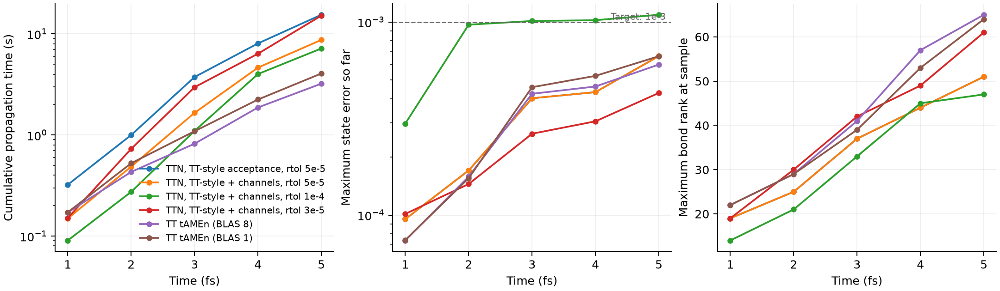
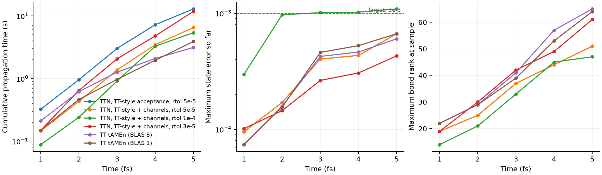

# Holstein：TT流の受理条件とチャネル環境（5 fs再測定）

[前回の比較](holstein_ttn_tamen.md)では、TTN tAMEnは3 fsまでに651秒かかり、TTより約541倍遅かった。
原因を調べると、木構造そのものよりも、TT tAMEnが行っていない次の処理が大きかった。

1. 解を許容誤差で切断しない（ランク上限96だけで、基底追加ごとにランクが増え続ける）
2. 区間ごとに大域残差を102項ずつ加算・圧縮して厳密に検証する（計算時間の96%）
3. 局所GMRESを実質 `1e-12·‖b‖` まで解く

これらをTTNSolverのオプションとして追加し、さらに局所環境のチャネル化（④）と
時間誤差推定の高速化（⑤）を加えて、同じ10サイトHolstein模型で5 fsまで測り直した。

**要約：** 5 fsまでで、TTN ①〜⑤はTTの2.71倍の時間だった（8.73秒、TTは3.22秒）。
その後の局所計算の改善（v2）で2.07倍（6.51秒、TTは3.14秒）まで縮まった。誤差は同程度（全状態6.7e-4、TTは6.0e-4）である。

## 診断の経緯

コード変更の前に、次の順で原因を切り分けた。計時はいずれも共用マシンで1回ずつ測ったもので、目安として扱う。

1. **保存状態の再切断。** [前回](holstein_ttn_tamen.md)の3 fsのTTN状態（36.6万要素）を相対1e-4で切断すると、5.4万要素に減った。
   TTとの差は3.5587e-4→3.5592e-4でほぼ変わらず、解の大部分は不要な方向だった。
   同じ許容誤差で切断すると、TTNの大きさはTTの0.7倍（1 fs）〜2.5倍（3 fs）だった。
2. **実験用プロセス内の試作。** パッケージは変更せず、`_tamen_step` の写しに①②を加えて3 fsまで走らせた。
   - rtol=1e-4：6.2秒。ただし全状態誤差は1.02e-3で、目標をわずかに超えた。
   - rtol=3e-5：13.5秒、誤差2.52e-4。
   - さらに③を加えると7.6秒、誤差2.64e-4。
   - ①の切断と厳密検証を組み合わせると、2.5 fsまでで900秒を超えた。検証は精度確認の手段にとどめ、受理条件からは外した。
3. **TTと同じ形の木。** TTと同じ並び（[ket, bra, 浴1…浴20]、時間の葉は末尾）の毛虫型の木で同じ設定を走らせた。
   3 fsまで13.3秒かかり、つり合い木（7.6秒）より遅かった。
   残る差は木の形ではなく、局所計算の実装効率だと判断した。
4. **プロファイル（3 fs区間、SoP経路）。** 項ごとの環境行列の構築が38%、局所GMRESが27%、時間誤差推定が16%を占めた。
   時間誤差推定の16%は、そのほとんどが初期射影誤差の `ttn_distance` だった。これが④⑤の対象になった。

## 結果

5 fsまでの伝播時間（3回の中央値と最小–最大）。誤差は精密TT参照に対する1 fsごとの最大値。

| 手法 | 5 fs時間 | 全状態誤差 | 密度行列誤差 | 最大ランク | TT（BLAS8）比 |
|---|---:|---:|---:|---:|---:|
| TT tAMEn、tol=1e-4、BLAS8 | 3.222秒（2.589–3.958） | 6.02e-4 | 1.29e-4 | 65 | 1 |
| TT tAMEn、tol=1e-4、BLAS1 | 4.061秒（3.586–4.227） | 6.65e-4 | 1.35e-4 | 64 | 1.26 |
| TTN ①②③⑤、rtol=5e-5 | 15.467秒（15.197–15.529） | 6.66e-4 | 9.88e-5 | 51 | 4.80 |
| TTN ①〜⑤、rtol=5e-5 | **8.725秒**（8.240–8.729） | 6.66e-4 | 9.88e-5 | 51 | **2.71** |
| TTN ①〜⑤、rtol=3e-5 | 15.159秒（14.973–15.222） | 4.29e-4 | 6.34e-5 | 61 | 4.70 |
| TTN ①〜⑤、rtol=1e-4 | 7.177秒（7.010–7.189） | 1.09e-3 | 3.05e-4 | 47 | 目標未達 |

3 fsまででは、TTが0.821秒、TTN ①〜⑤（rtol=5e-5）が1.657秒（2.02倍）だった。
前回の651秒と比べて約390倍速い。TTNは従来の実装では5 fsに到達できなかったが、今回は全設定が完走した。
rtol=1e-4の設定は全状態誤差の目標1e-3をわずかに超えたため、速度比を出していない。
TTNのrtolはTTのtolと意味が違う。同程度の精度には5e-5程度が必要だった。



ランクが増える後半ほど差が開く（3 fsで2.0倍、5 fsで2.7倍）。
5 fs以降の速度比は外挿しない。

## 変更内容

測定時の既定値は従来どおり（厳密検証あり、切断なし、SoP環境）で、各設定は明示的に指定した。
測定後、③と④を既定値に変更した（下記「既定値の変更」）。

| 番号 | オプション | 内容 |
|---|---|---|
| ① | `truncation_rtol=1e-5` | 毎スイープ後に、時空間解を重み付き切断する（予算は `1e-5·‖x‖`）。保存量と時間基底は保護する。`truncate!` に相対予算 `rtol` を追加した |
| ② | `certify=false` | 大域残差を作らず、補助残差の射影ノルムが目標以下なら受理する。`residual_method=:local` が必要 |
| ③ | `local_tol_factor=0.01` | 局所GMRESの許容誤差を、受理目標の1%（絶対値）にする |
| ④ | `local_operator=:channels` | 積和演算子を、区間ごとに厳密な疎TTNOに変換してALS環境に使う |
| ⑤ | （常に有効） | 時間誤差推定の初期射影誤差を、二乗ノルムの引き算を使わない再帰Gram計算で求める |

②の推定値は低ランクの補助TTNへの射影なので、真の残差を過小評価しうる。
受理は保証付きの誤差上界ではなく、参照解との比較で精度を確認する。これはTT tAMEnと同じ立場である。
①の予算は `rtol` 未満にする。根の再求解は、根以外で落とした方向を戻せない。

④では、各項を辺ごとに次の3種類に分ける。
- 部分木に作用しない項：恒等チャネル
- 部分木の中で閉じる項：完結チャネル（和をとる）
- 両側にまたがる項：一方の側の因子をキーにしたチャネル

係数は、項の作用する葉のうち、関わる項が最も少ない葉（ここでは浴の葉）で一度だけ掛ける。
各ノードの疎な遷移 `(α,β,γ,c)` から、上向き・下向きの環境と局所作用を導く。
Holsteinでは、浴部分木の辺のチャネルが `2+2×サイト数`（浴全体で22）、浴の葉が4になる。
従来の環境は項ごと（上位ノードで約60〜100個）だった。正規直交基底の恒等チャネルは厳密な単位行列として扱い、積を省く。
大域検証を使う場合は、従来どおりSoPを項ごとに適用する。

## 既定値の変更

③ `local_tol_factor=0.01` と ④ `local_operator=:channels` は受理条件を変えずに計算量だけを減らすため、
測定後に `tamen_step` の既定値にした。①と②は精度保証の意味を変えるので、引き続き明示的に指定する。
従来の動作は `local_tol_factor=nothing, local_operator=:sop` で戻せる。

ベンチマークの各設定は両方のオプションを明示しているため、上の結果の意味は変わらない。
ただし `output/tt_acceptance` の `metadata.toml` に記録したソースのハッシュは、既定値を変更する前のソースのものである。

## 内訳

3回の中央値。各列は伝播時間の内数で、GCは他の列と重なる。

| 設定 | 合計 | ALS | 環境構築 | 時間誤差推定 | GC | 行列ベクトル積 |
|---|---:|---:|---:|---:|---:|---:|
| ①②③（⑤なし、参考値） | 16.54秒 | 12.53 | 1.50 | 1.37 | 2.78 | 4826 |
| ①②③⑤ | 15.47秒 | 12.01 | 1.42 | 0.61 | 2.72 | 4826 |
| ①〜⑤ | 8.72秒 | 5.92 | 0.46 | 0.63 | 2.09 | 4826 |

④はALSを2.0倍、環境構築を3.1倍速くした。行列ベクトル積の回数と誤差は完全に一致し、
同じ反復をより安く計算している。⑤は時間誤差推定を約2.2倍速くした。

「⑤なし」の行は、①②③だけを入れた段階で測ったものである。
この実行中にソースを編集したため、記録されたソースのハッシュがケース間で一致していない。
1プロセスが開始時に読み込んだコードで全ケースを実行しているので、計時そのものは段階1のコードの値である。
ただし整合性検査を通らないため、参考値とする（`output/tt_acceptance_stage1_mixed_hashes/NOTE.txt`）。
正式な表は、ソースを凍結し、実行前後でハッシュの一致を確認した `output/tt_acceptance` の値である。

## 残る差（v1時点）

v2での対応は上の「追加の改善」を参照。
最終区間（4.5→5 fs、ランク51）を直列実行でプロファイルすると、
局所GMRESが約59%、環境構築が約16%を占めた。GCは区間時間の約3割で、確保量は1区間あたり2.46 GBだった。
次の候補は以下である。
- 局所作用の出力・中間配列の確保を減らす
- 局所解法の前処理や初期値を改善する
- 葉のランクが物理次元と同じ場合（今回の22葉すべて）に、葉の局所解法を省く

TTNの内部ノードは3本の結合を持つので、ランクが増える後半ほど不利になる。
木構造の検討（[前回の分析](holstein_ttn_tamen.md)）も引き続き課題である。

## 追加の改善（v2、`output/tt_acceptance_v2`）

上の結果をコミットした後、残っていた改善候補を実施した。
いずれも受理条件と反復の数学的内容は変えず、変わるのは浮動小数点の和の順序だけである。
効果は、保存した4.5 fsの状態と温め始動のヒントを固定入力にして、最終区間（4.5→5 fs）で測った。

| 改善 | 内容 | 最終区間での効果 |
|---|---|---|
| 温め始動の一致判定 | 初期状態と前区間の終点の配列が完全に一致すれば、距離計算を省く（一致しなければ従来の厳密判定） | 2.99→2.53秒、確保−0.25 GB |
| 局所残差の重複計算 | KrylovKitのGMRESが収束判定で明示的に再計算した `normres` を使う（契約をテストで確認） | 行列ベクトル積 560→426回 |
| フルランク葉の省略 | 基底が全空間を張る葉は解かない（親の再求解が同じ空間を解く） | 解法 134→109回（時間差は誤差内） |
| 並べ替えなしの縮約 | モード3は1回のGEMM、モード2はスライスごとのGEMM（親次元が小さいときは1回だけ並べ替え） | 確保 2.18→1.35 GB/区間 |

最終区間の計時はGCの揺らぎに埋もれやすい。そこで、コミット済みの版のgitワークツリーと交互に、5 fsの全軌道を2組×2回走らせて比べた。
誤差はすべて6.659e-4で一致した。

| 版 | 5 fs時間 | 確保量 |
|---|---:|---:|
| コミット済み（`8b5350e`） | 約9.3秒 | 8.8 GB |
| 上の表の上3つの改善のみ | 約8.3秒 | 7.66 GB |
| 4つの改善すべて | 約7.3秒 | 4.86 GB |

採用しなかったもの：

- **Etterスイープで、子へ降りる前の解法を省く。** 収束に3スイープ必要になった（従来は2）。区間時間は2.4秒→3.7秒に悪化した。
- **局所解法の前処理。** 1回の解法でのKrylov反復は平均約1.7回で、固定の演算子適用（初期残差、Arnoldiの開始、終了時の明示的な残差）が大半を占める。
  前処理で減らせる部分は小さい。漸化式の残差を信頼する独自のGMRESにすれば、反復した解法ごとに1回減らせる。
  ただし、約半数の解法は反復せずに戻り、そこではKrylovKitも再計算しないので、実測では368→325回（11.7%）にとどまる。
  同じ区間の43回の反復で、漸化式の残差と真の残差の差は最大でも許容誤差の2.9e-9倍、誤判定は0件だった。
  旧既定（約 `1e-12·‖b‖`）では3.6e-4倍まで広がる。失うのは主に、作用の実装の不具合（バッファの上書きや競合）を検出する安全網である。
  利得が小さいため保留した。

ソースを凍結し、ハッシュの一致を確認したうえで正式に再測定した（3回の中央値）。

| 手法 | 5 fs時間 | 全状態誤差 | 密度行列誤差 | TT（BLAS8）比 |
|---|---:|---:|---:|---:|
| TT tAMEn、BLAS8 | 3.142秒（2.435–3.580） | 6.02e-4 | 1.29e-4 | 1 |
| TT tAMEn、BLAS1 | 3.903秒（3.858–4.270） | 6.65e-4 | 1.35e-4 | 1.24 |
| TTN ①②③⑤（SoP） | 12.950秒（12.738–13.283） | 6.66e-4 | 9.88e-5 | 4.12 |
| TTN ①〜⑤、rtol=5e-5 | **6.511秒**（6.494–6.522） | 6.66e-4 | 9.88e-5 | **2.07** |
| TTN ①〜⑤、rtol=3e-5 | 11.818秒（11.746–12.105） | 4.29e-4 | 6.34e-5 | 3.76 |
| TTN ①〜⑤、rtol=1e-4 | 5.398秒（5.332–5.548） | 1.09e-3 | 3.05e-4 | 目標未達 |

TTN ①〜⑤の内訳は次のとおり（中央値）。前回はALS 5.92秒、行列ベクトル積4826回だった。
- ALS：5.25秒
- 環境構築：0.39秒
- 時間誤差推定：0.24秒
- GC：1.12秒
- 行列ベクトル積：3464回

3 fsまででは、TTNが1.376秒、TTが1.268秒だった。ただしTTの3回の範囲は0.502〜1.270秒と広く、3 fsでの比は不確かである。
5 fsでのTTとの差は2.7倍から2.1倍に縮まった。



## 測定条件と検証

- 2026-11-06、Julia 1.12.6、AMD Ryzen Threadripper PRO 9985WX。
- Julia 4スレッド。TTNはBLAS1、TTはBLAS8とBLAS1。
- TTNはEtter ALS（並列）、区間0.5 fs、Chebyshev 8点、maxrank 96、kickrank 4。
- 参照と精密参照も同じソースで再計算した。5 fsまでの両者の差は1e-4未満（`reference_convergence.csv`）。
- ウォームアップは冷えた初回区間と温め始動の区間の2区間に変更した。
  前回は1区間だったため、温め始動の初回コンパイル（約0.5秒）が、最初のTTNケースの伝播時間に入り得た。
- 伝播時間にはモデル構築・ウォームアップ・保存・精度検証を含めない。処理中のGCは含む。
- 測定時点で、TTNSolver 2827件、TTNDynamics 595件、ベンチマークの小系検証16件が通過した。
  既定値の変更後は、TTNSolver 2829件、TTNDynamics 595件が通過した。
  v2の改善後は、TTNSolver 2845件、TTNDynamics 595件、ベンチマークの小系検証16件が通過した。
- 新規テストは次を確認する。
  - オプションの効果・既定値の不変・入力検証
  - 保存量の保護と温め始動・適応区間での動作
  - 射影誤差：密行列の参照値、旧来の `ttn_distance` による値、非正規直交時のフォールバック
  - チャネル演算子：3体項・スカラー項・ゼロ係数・不規則な木で、全辺の `ΣD⊗U` と全局所作用がSoPと一致すること
  - HEOM型の演算子でのチャネル数

## 再現

```bash
HOLSTEIN_JULIA_THREADS=4 bash TTNDynamics/benchmarks/holstein_longtime/run.sh ../holstein_ttn_tamen/verify.jl
HOLSTEIN_JULIA_THREADS=4 timeout --kill-after=15s 3600s bash TTNDynamics/benchmarks/holstein_longtime/run.sh ../holstein_ttn_tamen/batch_tt_acceptance.jl
python3 TTNDynamics/benchmarks/holstein_ttn_tamen/summarize.py tt_acceptance
MPLCONFIGDIR=/tmp/ttn-mpl python3 TTNDynamics/benchmarks/holstein_ttn_tamen/plot.py tt_acceptance
```

- v2の再測定：上の手順で `HOLSTEIN_TTN_TAMEN_OUTPUT=tt_acceptance_v2` を指定し、`summarize.py`・`plot.py` に `tt_acceptance_v2` を渡す。
  結果は[v2の要約](../benchmarks/holstein_ttn_tamen/output/tt_acceptance_v2/summary.csv)。
- [要約](../benchmarks/holstein_ttn_tamen/output/tt_acceptance/summary.csv)
- [共通時刻の比較](../benchmarks/holstein_ttn_tamen/output/tt_acceptance/comparison.csv)
- [参照の収束](../benchmarks/holstein_ttn_tamen/output/tt_acceptance/reference_convergence.csv)
- [オプションとチャネル環境の説明](../../TTNSolver/docs/tamen.md#tt-style-acceptance-and-channel-environments)
