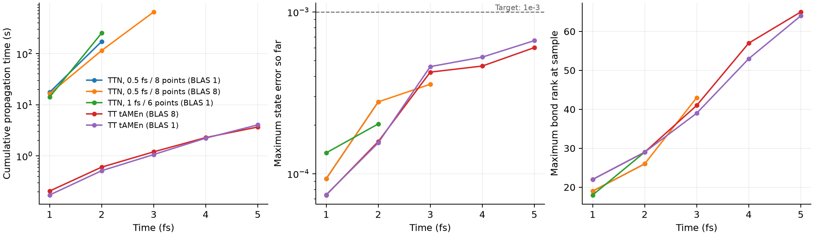

# HolsteinでのTT / TTN tAMEn比較

この測定後に実施したBUGのKrylov・恒等縮約最適化と、TTNO残差検証の試行は
[追加の最適化結果](reference_optimization.md)を参照。以下の5fs測定値は当時の実装の結果。

10サイトの周期Holstein模型で、ket/braを分離したHEOMを局在初期状態から5fsまで
計算する。TTとTTNには同じNoiseExpの係数、共役指数の対応、ADOスケールを使う。

| 設定 | 値 |
|---|---:|
| 飛び移り積分 | 400 cm⁻¹ |
| Brownian浴の周波数 | 800 cm⁻¹ |
| 減衰 | 300 cm⁻¹ |
| 再配置エネルギー | 800 cm⁻¹ |
| 温度 | 300 K |
| Padé次数 | 0 |
| 各浴指数の局所次元 | 5 |
| 初期状態 | サイト1に局在 |

## 比較方法

| 手法 | 外側区間幅 | 時間点数 | 許容誤差 | スレッド設定 |
|---|---:|---:|---:|---|
| TT参照 | 0.25 fs | 12 | 1e-6 | BLAS8 |
| TT精密参照 | 0.125 fs | 12 | 1e-7 | BLAS8 |
| TT tAMEn | 0.5 fs | 12 | 1e-4 | BLAS8と1 |
| TTN tAMEn | 0.5 fs | 8 | 1e-4 | Julia4、BLAS1 |
| TTN区間調整候補 | 1.0 fs | 6 | 1e-4 | Julia4、BLAS1 |
| TTN BLAS調整候補 | 0.5 fs | 8 | 1e-4 | Julia4、BLAS8 |

TTNはEtter ALS、解のmaxrank96、残差maxrankはその2倍、accepted warm startを使う。
TTの既存tAMEnには同じ意味の固定ランク上限を設定しない。全てトレースを保護する。
許容誤差パラメータの意味は手法間で同一ではないため、数値を揃えるだけで精度同等とは
判定しない。TTNの時間誤差推定値も記録するが、この比較の外側区間幅は固定する。

共通の1fsごとの保存時刻で、全階層状態の相対差と密度行列のFrobenius差を測る。
参照・精密参照の差が両方1e-4以下であることを確認し、精密参照に対して両方1e-3以下の
候補を精度目標達成とする。これは保存時刻での検証であり、区間内の連続した誤差上界
ではない。TT–TTNの距離は縮約から求めるため、1e-8程度以下の差は丸め誤差の影響を
受ける。比較目標1e-3はこの限界より十分大きい。

モデル構築・初回コンパイル・ウォームアップ・保存処理・精度検証を伝播時間から分離する。
TT候補は3回、参照とTTN候補はまず1回。各手法を順番に実行し、全体を約1時間に制限する。
タイムアウトや初期化失敗も `run_status.csv` に残し、途中結果を5fs完了として扱わない。

最初のTTN設定は2fsまでを校正用として記録し、その次の重い区間を停止した。
2fs時点の全階層状態誤差はTTN2.78e-4、TT1.58e-4で、許容誤差を大きく緩める
根拠はなかった。このため線形許容誤差は保ち、区間幅・時間点数を変える候補と、
元の区間幅のままBLAS8を使う候補を別ディレクトリで測定した。

## 測定結果

2026-11-06、Julia1.12.6、Threadripper PRO9985WX。伝播時間には処理中のGCを含む。
TTの時間は3回の中央値、TTNは各設定1回の測定であり、厳密な並列効率測定ではない。
スレッド数以外にCPU割り当てを固定していない。

参照と精密参照は5fsまで完了した。保存時刻全体での最大差は、全階層状態1.78e-5、
密度行列2.56e-6で、参照の基準1e-4を満たした。
比較・校正・最終精度検証に約53分を使った。TTNは最大3fsまでで打ち切り、
5fsでの速度比較は未達である。以下は完了した保存時刻までの結果であり、
中断した次の区間に費やした時間は伝播時間に含めていない。

| 手法 | 検証した範囲 | 伝播時間 | 最大状態誤差 | 最大密度行列誤差 | 最大ランク |
|---|---:|---:|---:|---:|---:|
| TT tAMEn、BLAS8 | 5 fs | 3.678秒 | 6.02e-4 | 1.29e-4 | 65 |
| TT tAMEn、BLAS1 | 5 fs | 4.059秒 | 6.65e-4 | 1.35e-4 | 64 |
| TTN、0.5fs/8点、BLAS1 | 2 fs | 172.525秒 | 2.78e-4 | 1.24e-5 | 26 |
| TTN、1fs/6点、BLAS1 | 2 fs | 251.953秒 | 2.03e-4 | 1.07e-5 | 29 |
| TTN、0.5fs/8点、BLAS8 | 3 fs | 651.309秒 | 3.57e-4 | 3.68e-5 | 43 |

TTNの2fsという途中結果をTTの5fsの時間で割って速度比を出してはいけない。
共通の2fsまでではTT（BLAS8）の中央値0.606秒に対し、初期TTN設定は172.525秒で、
同じ誤差目標1e-3を満たす範囲で約285倍遅かった。TTとTTNの結合ランクは異なる分割に
対する値であり、大小を直接圧縮効率の優劣とは解釈できない。

BLAS8への変更は、同じ2fsまでで172.525→114.883秒、約1.50倍の高速化だった。
一方、1fs/6点への変更では大域検証が5回から3回へ減っても、2fsまで251.953秒と
遅くなった。区間を広げて検証回数だけを減らす方法は、この試行では改善にならなかった。

3fsまでの共通範囲では、TT（BLAS8）が1.205秒・状態誤差4.25e-4に対し、
TTN（BLAS8）は651.309秒・3.57e-4だった。両方が精度目標を満たしても、
TTNは約541倍遅い。3fsまでの累積確保量もTT0.349 GB、TTN352.786 GBと大きく異なる。
これはピーク使用量ではなく、計算中の繰り返し確保を合計した値である。

初期TTN設定の2fsまでの残差検証は166.696秒、伝播時間の96.6%を占めた。
加算・正準化71.507秒、重み付けQR50.404秒、SVD5.419秒、基底更新38.066秒、
最終QR1.281秒だった。この設定では、ALSやSVDだけを高速化する効果は限られ、
項ごとの加算と圧縮を繰り返す大域残差構築が主な課題となる。

BLAS8の3fsまででも、残差検証624.241秒は全体の95.8%を占める。
内訳は加算・正準化288.121秒、重み付けQR202.790秒、SVD25.526秒、
基底更新102.845秒、最終QR4.918秒。今回のバッファ最適化だけでは差は埋まらず、
次の対象は残差の項ごとの加算・再圧縮を減らす構築方法になる。
誤差上界を弱めたり、未検証の解を採用したりして得た速度では比較しない。

TTNの線は最後に完了・検証した時刻で止めている。5fsへの外挿はしていない。

## 実行と検証

小さい2サイト・局所次元2の模型で、演算子の一致、TT/TTNの軸順序、密な行列指数との
時間発展の一致、トレース保存を検証済み。初期化失敗・ゼロ時間予算・参照不足の記録も
テストする。実行手順は[ベンチマークREADME](../benchmarks/holstein_ttn_tamen/README.md)を参照。

計算の進行と測定値は以下に保存する。

- [実行ログ](../benchmarks/holstein_ttn_tamen/output/batch.log)
- [試行状態](../benchmarks/holstein_ttn_tamen/output/five_fs/run_status.csv)
- [共通時刻の比較](../benchmarks/holstein_ttn_tamen/output/five_fs/comparison.csv)
- [参照解の収束確認](../benchmarks/holstein_ttn_tamen/output/five_fs/reference_convergence.csv)
- [時間・誤差・ランクの要約](../benchmarks/holstein_ttn_tamen/output/five_fs/summary.csv)
- [残差検証の内訳](../benchmarks/holstein_ttn_tamen/output/five_fs/phase_summary.csv)

今回の残差圧縮の変更は[実装と計時内訳](tamen_residual_compression.md)に記載する。
