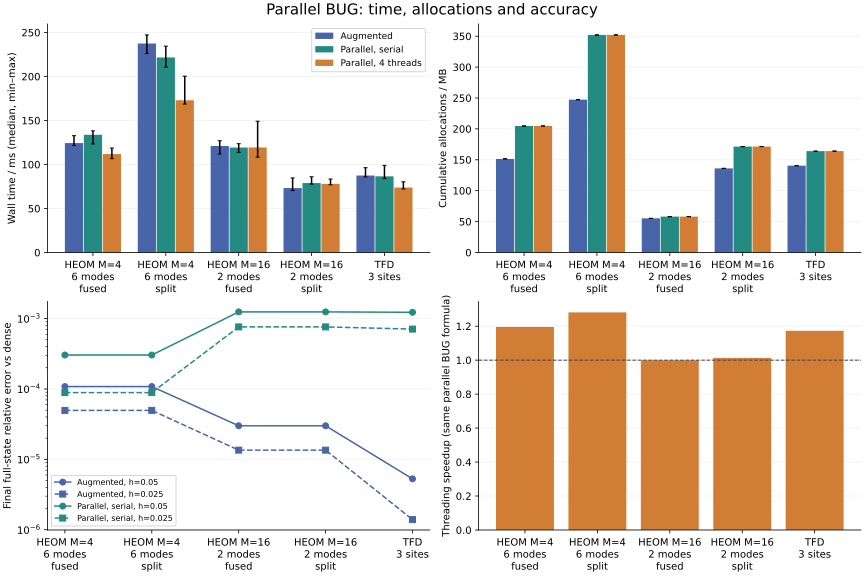

# Parallel BUG for HEOM and TFD

These are the initial implementation measurements. See the
[optimization report](parallel_bug_optimization.md) for the current compact
assembly implementation, paired before/after timings, and a common-error-target comparison.

Both model APIs accept `method=:parallel`; augmented BUG remains the default. Use a fixed grid for the standard workflow, or the keyword form for adaptive time steps.

```julia
fixed = heom_evolve(system, initial, 0:0.01:1; method=:parallel, threaded=true)
adaptive = heom_evolve(system, initial; tspan=(0.,1.), dt=0.01,
                       method=:parallel, threaded=true, atol=1e-8, rtol=1e-5)
# tfd_evolve accepts the same method/threaded options.
```

Parallel BUG [1] solves every node equation in the old bases, then assembles the evolved old/old block and explicit single-new-direction blocks. The double-new block is discarded. Only the local ODE phase is threaded; preparation, assembly and truncation still traverse the tree serially. `threaded=false` runs the identical formula serially. A one-worker Julia process falls back to serial execution.

HEOM inserts the trace functional's subtree spaces into the old basis and protects them during truncation. The measurements disable trace correction. TFD retains its initial `H*initial` enrichment and does not correct norm or energy. Parallel BUG does not generally conserve those quadratic quantities exactly.

## Measurements



Measured with BLAS=1, Julia worker threads=4, five warmed runs per variant, rotating execution order and collecting garbage before each timed run. The timed call includes model generator construction, enrichment, all steps and observations. Compilation warm-up and dense reference work are outside the timed region. Fixed grids: t=0…0.5, h=0.05; truncation atol=1e-10, maxrank=64. All measured steps met their truncation budgets. No TTN is expanded by the solver; dense arrays are used only in the benchmark reference.

| Case | Augmented ms | Parallel serial ms | Parallel 4 threads ms | Threading speedup |
|---|---:|---:|---:|---:|
| heom4_6_fused | 124.33 | 133.74 | 111.86 | 1.20× |
| heom4_6_split | 237.47 | 221.60 | 172.96 | 1.28× |
| heom16_2_fused | 120.99 | 119.29 | 119.37 | 1.00× |
| heom16_2_split | 73.22 | 78.91 | 77.90 | 1.01× |
| tfd3 | 87.48 | 86.58 | 73.81 | 1.17× |

Speedups compare the same mathematical parallel method. The augmented/parallel comparison at a common h includes a change of algorithm and accuracy; it is not a speedup at matched error. These small trees can be limited by scheduling, allocation and serial work. The results do not establish a universal benefit from more threads.

| Case | Augmented MB | Parallel serial MB | Parallel threaded MB | Max rank (aug. / par.) |
|---|---:|---:|---:|---:|
| heom4_6_fused | 151.42 | 204.70 | 204.78 | 17 / 17 |
| heom4_6_split | 247.27 | 352.03 | 352.12 | 17 / 17 |
| heom16_2_fused | 55.23 | 58.04 | 58.07 | 5 / 5 |
| heom16_2_split | 136.09 | 171.32 | 171.36 | 16 / 16 |
| tfd3 | 140.45 | 164.00 | 164.07 | 13 / 13 |

MB denotes cumulative allocated bytes, not peak resident memory.

## Accuracy and time-step refinement

The reference is a matrix exponential of independent direct ADO or thermofield equations at the same finite hierarchy/Fock cutoff. This checks numerical evolution, not physical cutoff convergence. Errors below are final full-state relative 2-norm errors.

| Case | Augmented error h → h/2 | Parallel error h → h/2 | Trace / norm drift (parallel, h) |
|---|---:|---:|---:|
| heom4_6_fused | 1.082e-04 → 4.962e-05 | 3.035e-04 → 8.881e-05 | 1.12e-15 |
| heom4_6_split | 1.082e-04 → 4.962e-05 | 3.035e-04 → 8.881e-05 | 6.55e-15 |
| heom16_2_fused | 2.999e-05 → 1.352e-05 | 1.245e-03 → 7.615e-04 | 1.51e-14 |
| heom16_2_split | 2.999e-05 → 1.352e-05 | 1.245e-03 → 7.615e-04 | 2.04e-14 |
| tfd3 | 5.284e-06 → 1.394e-06 | 1.228e-03 → 7.094e-04 | 3.95e-05 |

Serial and threaded parallel BUG final TTNs agree within 1.12e-15 in absolute TTN distance over all measured cases. The one-worker fallback was measured separately:

| Case | One worker, serial ms | One worker, threaded=true ms |
|---|---:|---:|
| heom4_6_fused | 115.88 | 117.62 |
| heom4_6_split | 217.79 | 221.33 |
| heom16_2_fused | 112.08 | 115.22 |
| heom16_2_split | 82.56 | 77.15 |
| tfd3 | 81.94 | 83.30 |

## Limits

This implements the base first-order algorithm (Algorithms 1–4 of [1]). `omitted_block_norms[node]` reports h times the norm of the discarded new/new derivative block. It is a local diagnostic, not a global error bound. The optional rank-expansion retry strategy in section 4.6 is not implemented. Adaptive mode uses step doubling; neither that estimate nor the omitted-block diagnostic can detect directions invisible to the reduced equations. Check time-step/rank convergence and initial basis enrichment. The split HEOM trace protection still requires maxrank ≥ M.

## Reproduce

From the package root:

```sh
OPENBLAS_NUM_THREADS=1 julia --threads=1 --startup-file=no --project=. benchmarks/parallel_bug/run.jl 5
OPENBLAS_NUM_THREADS=1 julia --threads=4 --startup-file=no --project=. benchmarks/parallel_bug/run.jl 5
python3 benchmarks/parallel_bug/plot.py
```

[Benchmark sources and raw data](../benchmarks/parallel_bug/) include all runs, convergence data and environment/source hashes. Re-running replaces the corresponding CSV files, figures and this report.

```text
Measured: 2026-11-05T11:49:31.255
Julia: 1.12.6
CPU: AMD Ryzen Threadripper PRO 9985WX 64-Cores
Julia worker threads: 4
BLAS threads: 1
Repetitions: 5
KrylovKit: 0.10.4
bug.jl sha256: d747c2e4ce5a8f94b4072465b5ee68cc223b83a086249e53cf664438c59babc8
parallel_bug.jl sha256: 463b46e7589d7450d3a1f094af81a910381703de5d2fe8a3989b85969bf64c90
contractions.jl sha256: ca0b1d8a6749f0909be7629c3a49cae63b30985143d5dfa15f99254c020bb47f
```

## References

1. G. Ceruti, J. Kusch, C. Lubich and D. Sulz, “A Parallel Basis Update and Galerkin Integrator for Tree Tensor Networks,” SIAM J. Sci. Comput. 48(1), A27–A48 (2026), [doi:10.1137/24M1714502](https://doi.org/10.1137/24M1714502); [open preprint](https://arxiv.org/abs/2412.00858).
2. The authors’ [reproduction code](https://github.com/JonasKu/Publication-Parallel-BUG-for-TTNs), Section5.1/parallel_TTN_integrator, was consulted for the block assembly. The local Julia implementation uses SoP contractions and Arnoldi exponential actions.
