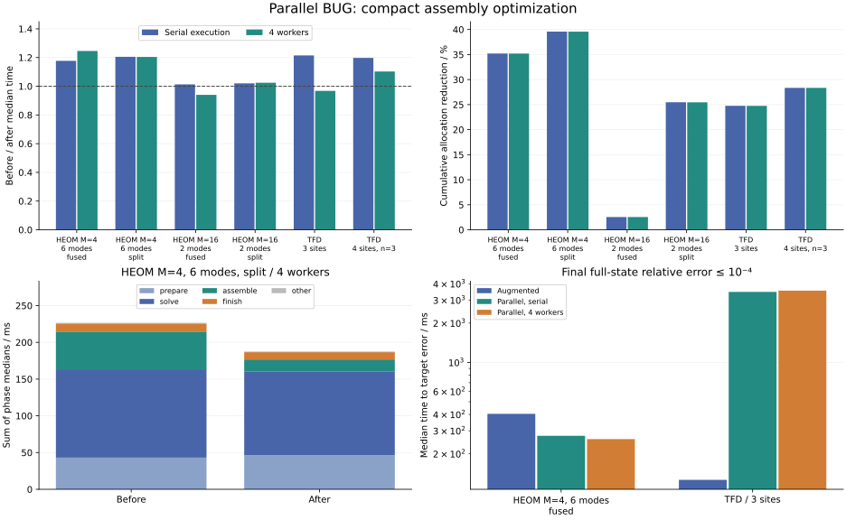

# Parallel BUG optimization

The update formula and public options are unchanged. The implementation now contracts only the newly added basis directions, skips empty blocks, reuses temporary storage across product terms, and reuses complete leaf bases and their reduced operators. No tolerances are relaxed and no rank-expansion retry is enabled.

The initial sampling profile (M=4, six-mode split HEOM, serial execution) put about 51% of active evolution samples inside local Arnoldi solves, 19% in preparation, and 17% in the general RHS contractions for block assembly. These are inclusive sampling counts, not disjoint wall times. The new rectangular contractions remove multiplication by explicitly zero old-basis rows and avoid per-term permutation allocations.



## Paired timing

Five warmed runs per version, rotating before/after order in the same Julia process, with four worker threads and BLAS=1. Both variants use the same trajectory/observation loop, t=0…0.5, h=0.05, truncation atol=1e-10 and maxrank=64. Model setup, initial TFD enrichment, all solves, truncation and observations are timed. GC is collected before each call; any GC during the call remains included. This was not an isolated host; report ranges as well as medians and avoid interpreting small timing differences.

| Case | Execution | Before ms (min–max) | After ms (min–max) | Speedup | Allocation reduction |
|---|---|---:|---:|---:|---:|
| heom4_6_fused | serial | 168.18 (128.79–221.15) | 142.88 (113.94–179.89) | 1.18× | 35.2% |
| heom4_6_fused | 4 workers | 132.45 (118.14–155.78) | 106.30 (105.84–129.23) | 1.25× | 35.2% |
| heom4_6_split | serial | 232.41 (218.35–311.18) | 192.85 (186.97–288.72) | 1.21× | 39.6% |
| heom4_6_split | 4 workers | 223.47 (179.01–243.49) | 185.56 (170.90–212.08) | 1.20× | 39.6% |
| heom16_2_fused | serial | 117.06 (112.28–187.86) | 115.57 (112.83–140.60) | 1.01× | 2.5% |
| heom16_2_fused | 4 workers | 120.76 (113.12–147.99) | 128.44 (120.27–142.26) | 0.94× | 2.5% |
| heom16_2_split | serial | 79.30 (78.39–104.82) | 77.73 (73.68–86.44) | 1.02× | 25.5% |
| heom16_2_split | 4 workers | 86.81 (83.64–98.07) | 84.74 (75.58–89.22) | 1.02× | 25.5% |
| tfd3 | serial | 112.09 (85.02–143.53) | 92.29 (79.80–130.34) | 1.21× | 24.8% |
| tfd3 | 4 workers | 89.84 (81.80–111.43) | 92.82 (77.01–102.29) | 0.97× | 24.7% |
| tfd4_large | serial | 8465.92 (7757.64–8513.12) | 7069.80 (6932.13–7117.89) | 1.20× | 28.3% |
| tfd4_large | 4 workers | 7124.68 (6941.69–7270.05) | 6461.51 (6256.97–6828.58) | 1.10× | 28.3% |

Allocation reduction is cumulative allocated bytes, not peak memory. The larger TFD fixture has four sites, eight thermofield modes and three Fock states per mode (104,976 dense coefficients); it is compared in TTN form without a dense reference. The smaller fixtures match the [initial implementation comparison](parallel_bug.md).

## Numerical equivalence

Across these trajectories the largest before/after TTN distance is 1.100e-10, the largest observed density difference is 1.518e-13, and the largest change in a reported h*eta diagnostic is 1.524e-17. Saved rank histories are different in tfd4_large; identical in the remaining cases. Before/after truncation-budget pass/fail histories also agree. HEOM root trace correction is disabled; TFD has no norm correction. State differences at rounding or truncation scale do not establish physical cutoff convergence.

| Case | Maximum rank | Steps exceeding truncation budget (of 10) | Maximum trace / norm drift |
|---|---:|---:|---:|
| heom4_6_fused | 17 | 0 | 5.884e-15 |
| heom4_6_split | 17 | 0 | 5.777e-15 |
| heom16_2_fused | 5 | 0 | 2.709e-14 |
| heom16_2_split | 16 | 0 | 2.487e-14 |
| tfd3 | 13 | 0 | 3.946e-05 |
| tfd4_large | 64 | 2 | 1.536e-05 |

The large TFD case hits maxrank=64 and therefore does not meet the requested truncation budget on every step. It measures performance and equivalence of the same capped calculation; it is not an accuracy or rank-convergence claim. Increasing maxrank would require a separate convergence and cost study.

## Where time remains

The following separately instrumented runs split preparation, joined node solves, block assembly, and truncation/invariant finalization. Production code reads no clocks for this benchmark. The benchmark loads isolated instrumented copies with checked insertion points. Phase medians need not sum to the median uninstrumented trajectory time.

| Case / 4 workers | Version | Prepare ms | Local ODE ms | Assemble ms | Truncate/correct ms | Other ms |
|---|---|---:|---:|---:|---:|---:|
| heom4_6_fused | before | 20.20 | 67.78 | 41.58 | 10.46 | 0.90 |
| heom4_6_fused | after | 18.12 | 66.99 | 10.57 | 10.30 | 0.81 |
| heom4_6_split | before | 43.14 | 120.20 | 51.28 | 11.05 | 0.91 |
| heom4_6_split | after | 46.62 | 113.96 | 16.13 | 9.92 | 0.85 |
| heom16_2_fused | before | 8.95 | 97.65 | 13.69 | 4.11 | 3.15 |
| heom16_2_fused | after | 8.96 | 100.02 | 12.32 | 3.83 | 3.65 |
| heom16_2_split | before | 14.82 | 47.19 | 19.84 | 10.48 | 4.17 |
| heom16_2_split | after | 16.72 | 48.23 | 8.20 | 10.40 | 4.35 |
| tfd3 | before | 9.27 | 48.57 | 18.43 | 7.47 | 11.64 |
| tfd3 | after | 9.77 | 49.91 | 6.68 | 6.75 | 11.73 |
| tfd4_large | before | 657.78 | 3880.78 | 1621.34 | 389.39 | 833.97 |
| tfd4_large | after | 666.73 | 4420.96 | 920.73 | 435.53 | 705.39 |

## Common accuracy target

For two small models, search h=0.05/2^j (j=0…8) from coarse to fine and take the first grid whose final full-state relative error is ≤1e-4 against an independent dense matrix exponential. Warm that selected configuration and measure five times. This is a comparison at a common target on a discrete set of grids, not an optimized work/error curve or a guarantee on errors at all intermediate times. Parallel timings here use the optimized implementation.

| Case | Method | Selected h | Final relative error | Median ms (min–max) |
|---|---|---:|---:|---:|
| heom4_6_fused | augmented | 0.025 | 4.962e-05 | 404.13 (375.89–463.97) |
| heom4_6_fused | parallel_serial | 0.025 | 8.881e-05 | 274.66 (268.24–399.65) |
| heom4_6_fused | parallel_threads | 0.025 | 8.881e-05 | 258.94 (239.06–306.59) |
| tfd3 | augmented | 0.05 | 5.284e-06 | 126.34 (91.49–144.75) |
| tfd3 | parallel_serial | 0.0015625 | 6.705e-05 | 3464.96 (3346.69–3809.20) |
| tfd3 | parallel_threads | 0.0015625 | 6.705e-05 | 3544.32 (2910.50–3641.95) |

The common-h optimization saves work, but does not reduce the time discretization error of parallel BUG. Use the target-error comparison when choosing an integrator; augmented BUG remains the default. The optional basis-expansion retry of the parallel paper is still unimplemented; the existing omitted-block diagnostics and step doubling do not guarantee detection of directions invisible to the reduced equations.

## Reproduce

From the package root:

```sh
OPENBLAS_NUM_THREADS=1 julia --threads=4 --startup-file=no --project=. benchmarks/parallel_bug_optimization/run.jl 5
OPENBLAS_NUM_THREADS=1 julia --threads=4 --startup-file=no --project=. benchmarks/parallel_bug_optimization/accuracy.jl 5
python3 benchmarks/parallel_bug_optimization/plot.py
```

The [benchmark folder](../benchmarks/parallel_bug_optimization/) contains CSV data, the baseline sampling profile, instrumentation, and a frozen pre-optimization parallel step. The frozen step uses unchanged shared contraction/preparation/truncation primitives, whose hashes are recorded below. Ordinary before/after timings do not include phase instrumentation. The recorded measurements were collected in two batches: the large case was resumed after identifying its rank-cap limitation. The workspace-file hash changed only because an allocation comment was clarified; its numerical function body did not change between batches.

```text
Measured: 2026-11-05T12:11:40.766
Julia: 1.12.6
CPU: AMD Ryzen Threadripper PRO 9985WX 64-Cores
Worker threads: 4
BLAS threads: 1
Repetitions: 5
KrylovKit: 0.10.4
Baseline parallel_bug.jl sha256: 463b46e7589d7450d3a1f094af81a910381703de5d2fe8a3989b85969bf64c90
parallel_bug.jl sha256: c5eac6d6abb80c3651e0f59b07121924ca5673b7dec200100d64320604c619a3
parallel_workspaces.jl sha256: e7038134592727ed77ae96c6af35f8fed848d7b14bc6a96dd6aa2ef1b4c4e508
bug.jl sha256: d747c2e4ce5a8f94b4072465b5ee68cc223b83a086249e53cf664438c59babc8
contractions.jl sha256: ca0b1d8a6749f0909be7629c3a49cae63b30985143d5dfa15f99254c020bb47f
Measured: 2026-11-05T12:16:58.674
Julia: 1.12.6
CPU: AMD Ryzen Threadripper PRO 9985WX 64-Cores
Worker threads: 4
BLAS threads: 1
Repetitions: 5
KrylovKit: 0.10.4
Baseline parallel_bug.jl sha256: 463b46e7589d7450d3a1f094af81a910381703de5d2fe8a3989b85969bf64c90
parallel_bug.jl sha256: c5eac6d6abb80c3651e0f59b07121924ca5673b7dec200100d64320604c619a3
parallel_workspaces.jl sha256: 49e271c3a5deb4fa8c467be7a20bb41b53c4f6ff9fd73e9d08acb750d666ed09
bug.jl sha256: d747c2e4ce5a8f94b4072465b5ee68cc223b83a086249e53cf664438c59babc8
contractions.jl sha256: ca0b1d8a6749f0909be7629c3a49cae63b30985143d5dfa15f99254c020bb47f
```

The underlying first-order method is unchanged from G. Ceruti, J. Kusch, C. Lubich and D. Sulz, “A Parallel Basis Update and Galerkin Integrator for Tree Tensor Networks,” SIAM J. Sci. Comput. 48(1), A27–A48 (2026), [doi:10.1137/24M1714502](https://doi.org/10.1137/24M1714502).
