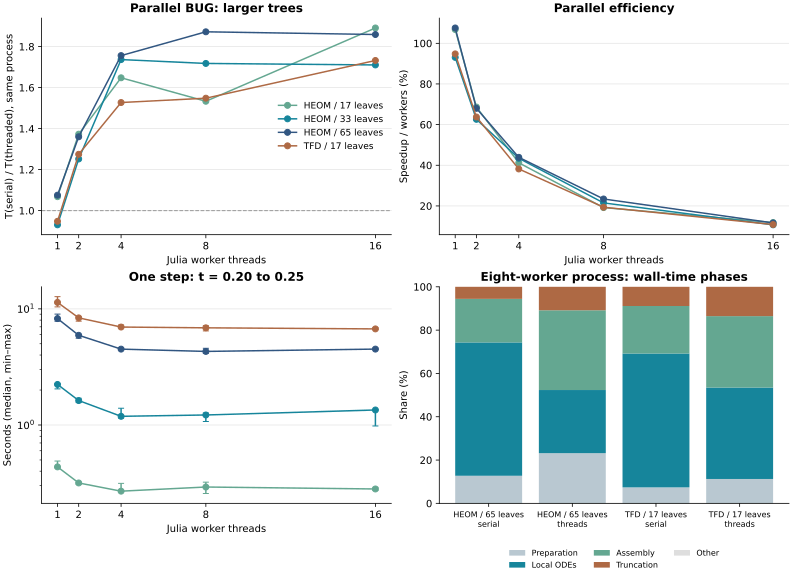
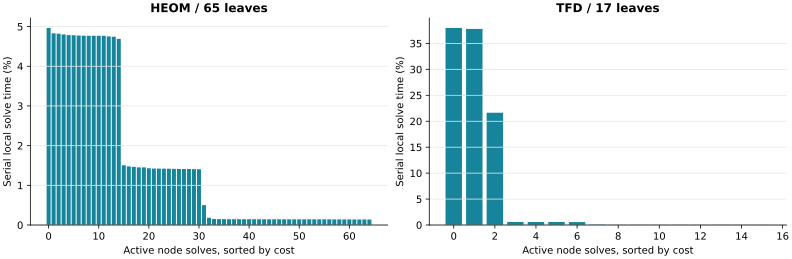

# Parallel BUG on larger trees

This study increases the number of physical leaves and independent node solves. It uses the existing parallel BUG implementation without solver changes, comparing `threaded=false` and `true` in processes with 1, 2, 4, 8 and 16 Julia workers. One-worker requested threading falls back to the identical serial path; differences between its paired timings are variability, not parallel acceleration.



## Controlled workloads

All systems have electronic dimension M=4 and local bath dimension 3. HEOM uses 16, 32 or 64 modes, giving 17, 33 or 65 leaves (33, 65 or 129 total nodes). TFD uses 16 signed thermal modes, giving 17 leaves and 33 nodes. A system leaf and a balanced bath subtree meet at the root. Coupling types/sites are interleaved in bath order.

HEOM keeps the sum of forward coefficients at 0.64+0.08im and uses conjugate backward coefficients. Four diagonal coupling types repeat; decay rates sample 0.8…1.5. TFD has four sites with two physical oscillators per site, transformed at beta=2 into signed pairs. Frequencies sample 0.6…1.0 and each physical amplitude is 0.3/sqrt(oscillators per site), keeping the sum of squared amplitudes at 0.36. These are controlled performance fixtures, not fitted/converged bath models. Increasing mode count also increases the SoP term count; this is not a pure topology change at fixed operator size.

The common step size is h=0.05. Four serial steps first construct a snapshot at t=0.20. Every timed call starts from that same read-only snapshot and advances one step to t=0.25, with truncation atol=1e-10, maxrank=64 and default Krylov settings. Root invariant correction is off. Each call includes QR/environment preparation, local solves, block assembly and truncation. Snapshot/model construction, observations and numerical comparisons are outside timing. This differs from the [earlier five-step trajectory study](parallel_threads.md); compare scaling ratios with care, not absolute times.

TFD's initial basis seed includes H times the vacuum state. Number terms annihilating the vacuum are omitted only during that one-time seed construction; the full Hamiltonian is used for evolution. A small fixture check confirms equality of the full and reduced seed directions. Redundant zero-weight bases can differ from earlier bootstrap constructions.

Julia 1.12.6, AMD Ryzen Threadripper PRO 9985WX 64-Cores, KrylovKit 0.10.4. BLAS threads = 1; GC threads = 1. After 1 warmup per execution mode, 3 serial/threaded pairs alternate call order. Explicit GC runs outside timing; collections during a step are included. This is a shared host: ranges are observed variability, not confidence intervals.

| Case | Leaves / nodes | Tree height | SoP terms | Input → output max rank | Local solves / skipped full leaves | Largest local dimension |
|---|---:|---:|---:|---:|---:|---:|
| HEOM / 17 leaves | 17 / 33 | 5 | 49 | 16 → 32 | 17 / 16 | 4096 |
| HEOM / 33 leaves | 33 / 65 | 6 | 97 | 16 → 32 | 33 / 32 | 4096 |
| HEOM / 65 leaves | 65 / 129 | 7 | 193 | 16 → 32 | 65 / 64 | 4096 |
| TFD / 17 leaves | 17 / 33 | 5 | 33 | 64 → 64 | 16 / 17 | 102400 |

Input trees with bond ranks: [HEOM / 17 leaves](../benchmarks/parallel_large_trees/figures/trees/heom16.svg), [HEOM / 33 leaves](../benchmarks/parallel_large_trees/figures/trees/heom32.svg), [HEOM / 65 leaves](../benchmarks/parallel_large_trees/figures/trees/heom64.svg), [TFD / 17 leaves](../benchmarks/parallel_large_trees/figures/trees/tfd16.svg). They are rendered with TTNPlots from the saved topology CSVs.

## Measured speedup

For the 65-leaf HEOM tree, the same-process speedup is 1.36× / 1.76× / 1.87× / 1.86× at 2/4/8/16 workers. Its best threaded median is 4.30 s at eight workers; sixteen workers take 4.50 s. Thus this workload benefits more than the earlier small trees, but remains far from linear scaling. Efficiency is about 23% at eight workers and 12% at sixteen.

The best measured threaded medians for the 17- and 33-leaf HEOM trees are 0.269 s and 1.187 s, both at four workers. Same-process ratios can rise when a particular process's serial baseline is slower: for example, the 17-leaf ratio is highest at sixteen workers even though its threaded median is slower than at four. Prefer the absolute timings and ranges as well as ratios when choosing a worker count.

Speedup is serial median / threaded median within the same process. Efficiency is that ratio / worker count. The last column separately reports the one-worker serial baseline ratio; between-process host variation can change it.

| Case | Workers | Serial s | Threaded s (min–max) | Speedup | Efficiency | 1-worker baseline ratio |
|---|---:|---:|---:|---:|---:|---:|
| HEOM / 17 leaves | 1 | 0.465 | 0.436 (0.427–0.489) | 1.07× | 106.8% | 1.07× |
| HEOM / 17 leaves | 2 | 0.435 | 0.317 (0.308–0.318) | 1.37× | 68.6% | 1.47× |
| HEOM / 17 leaves | 4 | 0.444 | 0.269 (0.268–0.314) | 1.65× | 41.2% | 1.73× |
| HEOM / 17 leaves | 8 | 0.448 | 0.292 (0.257–0.322) | 1.53× | 19.2% | 1.59× |
| HEOM / 17 leaves | 16 | 0.532 | 0.281 (0.273–0.290) | 1.89× | 11.8% | 1.65× |
| HEOM / 33 leaves | 1 | 2.079 | 2.234 (2.045–2.258) | 0.93× | 93.1% | 0.93× |
| HEOM / 33 leaves | 2 | 2.032 | 1.623 (1.560–1.698) | 1.25× | 62.6% | 1.28× |
| HEOM / 33 leaves | 4 | 2.062 | 1.187 (1.144–1.394) | 1.74× | 43.4% | 1.75× |
| HEOM / 33 leaves | 8 | 2.095 | 1.219 (1.072–1.269) | 1.72× | 21.5% | 1.70× |
| HEOM / 33 leaves | 16 | 2.303 | 1.346 (0.981–1.350) | 1.71× | 10.7% | 1.54× |
| HEOM / 65 leaves | 1 | 8.865 | 8.243 (7.819–9.003) | 1.08× | 107.5% | 1.08× |
| HEOM / 65 leaves | 2 | 8.049 | 5.918 (5.583–5.938) | 1.36× | 68.0% | 1.50× |
| HEOM / 65 leaves | 4 | 7.902 | 4.499 (4.467–4.605) | 1.76× | 43.9% | 1.97× |
| HEOM / 65 leaves | 8 | 8.049 | 4.299 (4.133–4.572) | 1.87× | 23.4% | 2.06× |
| HEOM / 65 leaves | 16 | 8.368 | 4.501 (4.464–4.591) | 1.86× | 11.6% | 1.97× |
| TFD / 17 leaves | 1 | 10.772 | 11.363 (10.396–12.735) | 0.95× | 94.8% | 0.95× |
| TFD / 17 leaves | 2 | 10.658 | 8.360 (7.832–8.452) | 1.27× | 63.7% | 1.29× |
| TFD / 17 leaves | 4 | 10.643 | 6.969 (6.926–7.268) | 1.53× | 38.2% | 1.55× |
| TFD / 17 leaves | 8 | 10.627 | 6.863 (6.455–7.161) | 1.55× | 19.4% | 1.57× |
| TFD / 17 leaves | 16 | 11.638 | 6.718 (6.650–6.888) | 1.73× | 10.8% | 1.60× |

## Numerical checks and rank limits

Each pair compares final TTN distance, density, retained ranks, truncation status, local-solve/skip counts and omitted-block h*eta diagnostics. The original snapshot is checked for mutation after all trials. No dense global tensor is built. Allocations are cumulative, not peak memory.

The [fixture verification](../benchmarks/parallel_large_trees/data/verification.txt) passed 31 checks of tree sizes, coupling normalization, initial states and seed-direction equality. All 120 repeated timing rows have matching serial/threaded ranks and pass the equivalence assertions; source hashes and group counts were checked separately.

| Case | Max serial/thread distance | Density difference | Pre-step truncation misses / 4 | Measured step meets tolerance | Largest discarded bound | Invariant drift in measured step | Allocated GB (8 workers) |
|---|---:|---:|---:|---|---:|---:|---:|
| HEOM / 17 leaves | 5.77e-16 | 0.00e+00 | 0 | yes | 0.00e+00 | 6.67e-16 | 0.65 |
| HEOM / 33 leaves | 6.22e-16 | 0.00e+00 | 0 | yes | 0.00e+00 | 4.44e-16 | 2.46 |
| HEOM / 65 leaves | 4.57e-16 | 0.00e+00 | 0 | yes | 0.00e+00 | 8.89e-16 | 9.47 |
| TFD / 17 leaves | 5.48e-15 | 0.00e+00 | 1 | no | 4.06e-06 | 8.59e-07 | 8.29 |

The TFD fixture reaches maxrank=64 and misses the requested truncation budget. Its measurements compare identical capped calculations; they are not an accuracy or rank-convergence claim. Norm drift also contains the parallel BUG time-discretization contribution. The HEOM results must still be checked for time and bath-cutoff convergence before physical use.

## Why speedup saturates

A separate eight-worker process measures three instrumented steps per mode on an isolated source copy, checked against the ordinary solver. The ordinary timing trials above contain no extra timers. Only local ODEs run concurrently; preparation, assembly and truncation are sequential. Timing changes in those sequential phases reflect variation/cache/GC effects, not new parallelism.

| Case | Execution | Preparation s | Local ODEs s | Assembly s | Truncation s | Other s |
|---|---|---:|---:|---:|---:|---:|
| HEOM / 65 leaves | serial | 1.020 | 4.931 | 1.611 | 0.445 | 0.000 |
| HEOM / 65 leaves | threads | 0.990 | 1.245 | 1.573 | 0.463 | 0.000 |
| TFD / 17 leaves | serial | 0.761 | 6.380 | 2.266 | 0.914 | 0.000 |
| TFD / 17 leaves | threads | 0.722 | 2.708 | 2.115 | 0.869 | 0.000 |

For the 65-leaf HEOM case, the local ODE phase falls from 4.93 s to 1.25 s (3.96×), while preparation, assembly and truncation retain about 3.03 s. Those sequential phases occupy about 71% of the sum of phase medians with eight workers. Further whole-step acceleration therefore needs work on preparation and assembly as well as the local solves.




| Case | Local ODE phase speedup | Heaviest active node | Its share of serial local solve time | Sum / heaviest node time |
|---|---:|---:|---:|---:|
| HEOM / 65 leaves | 3.96× | 80 | 5.0% | 20.14 |
| TFD / 17 leaves | 2.36× | 24 | 38.0% | 2.63 |

Node timers include workspace setup and local solve bookkeeping. Their sums are not parallel wall time. Full-leaf skips are excluded from the cost-distribution figure. Sum/heaviest is an optimistic work-imbalance ceiling for the local routine alone, not a whole-step speedup prediction. More leaves supply more independent work, but imbalance, serial phases, allocation/GC and task scheduling remain.

## Larger TFD pilot

An additional 33-leaf / 65-node TFD fixture was probed once at 8 workers: approximately 100.1 s serial versus 54.0 s threaded (1.85×), with about 50.6 GB cumulative allocations per call. It uses input rank 64, reaches augmented rank 128, and misses the truncation budget. This single pilot pair has no separate per-mode warmup and is excluded from the repeated scaling table. Its state difference was 5.60e-15. The [raw pilot log](../benchmarks/parallel_large_trees/data/pilot.txt) also records setup costs and the smaller pilot cases.

## Reproduce

From the TTNDynamics package root:

```sh
OPENBLAS_NUM_THREADS=1 julia --project=. benchmarks/parallel_large_trees/verify_fixtures.jl
for n in 1 2 4 8 16; do
  OPENBLAS_NUM_THREADS=1 JULIA_NUM_GC_THREADS=1 julia --threads=$n --project=. benchmarks/parallel_large_trees/run.jl 3
done
OPENBLAS_NUM_THREADS=1 JULIA_NUM_GC_THREADS=1 julia --threads=8 --project=. benchmarks/parallel_large_trees/stages.jl
julia --project=examples benchmarks/parallel_large_trees/trees.jl
python3 benchmarks/parallel_large_trees/plot.py
```

The [raw data and source/environment hashes](../benchmarks/parallel_large_trees/data/), [fixtures](../benchmarks/parallel_large_trees/fixtures.jl), [runner](../benchmarks/parallel_large_trees/run.jl), and [phase instrumentation](../benchmarks/parallel_large_trees/stages.jl) are retained. To repeat the extra TFD pilot, run `pilot.jl tfd32` with eight workers; it is substantially more expensive.

For the algorithm and its limits, see [parallel BUG](parallel_bug.md) and G. Ceruti, J. Kusch, C. Lubich and D. Sulz, *A Parallel Basis Update and Galerkin Integrator for Tree Tensor Networks*, [doi:10.1137/24M1714502](https://doi.org/10.1137/24M1714502).
