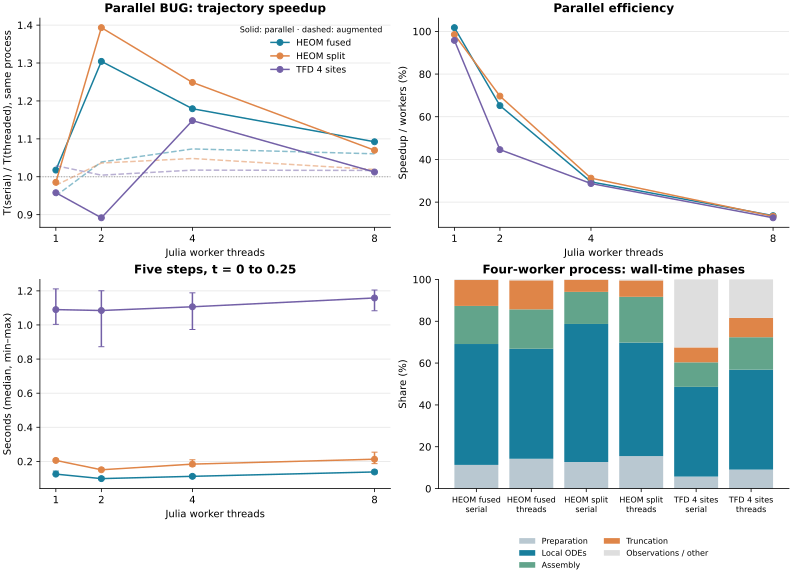

# Parallel BUG thread scaling

For up to 65 leaves and 16 workers, see the [larger-tree study](parallel_large_trees.md).

This measures `parallel_bug_step` with `threaded=false` versus `threaded=true`. All node equations use old bases and may run concurrently, including nodes at different tree levels. Preparation, cross-block assembly and final truncation remain sequential. The solver implementation is unchanged by this benchmark.

The fixtures and trajectory loop are reused directly from the [augmented BUG study](augmented_threads.md): HEOM M=4 with eight size-3 hierarchy modes (fused/split), and four-site TFD with eight size-3 thermal modes. Each full state space contains 104,976 complex coefficients; no global dense state is formed.



## Conditions

Julia 1.12.6, AMD Ryzen Threadripper PRO 9985WX, KrylovKit 0.10.4. Julia workers = 1/2/4/8, BLAS = 1, GC workers = 1. Each case uses two warmups per execution mode followed by five alternating serial/threaded pairs in the same process. Explicit GC is outside timing; GC during evolution is included. The host is shared, so small differences should be interpreted with the observed ranges.

Five fixed steps cover t=0…0.25 with h=0.05, truncation atol=1e-10, maxrank=64 and default Krylov options. Model construction and initial TFD enrichment are excluded; per-step preparation, solves, assembly, truncation and observations are included. HEOM root trace correction is off; TFD has no norm correction. This is an early-rank-growth workload, not a long-time scaling or convergence claim.

## Whole-trajectory speedup

For HEOM, two workers give the best observed whole-trajectory speedups: 1.30× (fused) and 1.39× (split), or about 65–70% efficiency. Four workers give 1.18–1.25×, and eight only 1.07–1.09×. This is a clearer benefit than the earlier augmented measurements, but it saturates quickly. TFD is variable: 0.89× / 1.15× / 1.01× at 2/4/8 workers, so this dataset does not establish a consistent gain there.

Speedup is the ratio of serial and threaded medians from the same process. Efficiency is speedup divided by worker count. The last column separately reports the one-worker serial baseline ratio; it is more exposed to between-process load changes.

| Case | Workers | Serial s | Threaded s (min–max) | Speedup | Efficiency | 1-worker baseline ratio |
|---|---:|---:|---:|---:|---:|---:|
| HEOM fused | 1 | 0.128 | 0.125 (0.123–0.143) | 1.02× | 101.8% | 1.02× |
| HEOM fused | 2 | 0.129 | 0.099 (0.096–0.109) | 1.30× | 65.2% | 1.29× |
| HEOM fused | 4 | 0.133 | 0.112 (0.104–0.121) | 1.18× | 29.5% | 1.14× |
| HEOM fused | 8 | 0.151 | 0.138 (0.128–0.148) | 1.09× | 13.7% | 0.92× |
| HEOM split | 1 | 0.203 | 0.206 (0.200–0.213) | 0.99× | 98.5% | 0.99× |
| HEOM split | 2 | 0.210 | 0.151 (0.150–0.160) | 1.39× | 69.7% | 1.34× |
| HEOM split | 4 | 0.230 | 0.184 (0.172–0.209) | 1.25× | 31.2% | 1.10× |
| HEOM split | 8 | 0.228 | 0.213 (0.187–0.254) | 1.07× | 13.4% | 0.95× |
| TFD 4 sites | 1 | 1.044 | 1.090 (1.004–1.211) | 0.96× | 95.8% | 0.96× |
| TFD 4 sites | 2 | 0.967 | 1.085 (0.873–1.201) | 0.89× | 44.6% | 0.96× |
| TFD 4 sites | 4 | 1.270 | 1.107 (0.973–1.188) | 1.15× | 28.7% | 0.94× |
| TFD 4 sites | 8 | 1.173 | 1.158 (1.083–1.205) | 1.01× | 12.7% | 0.90× |

Dashed curves in the speedup plot reproduce the earlier augmented measurements. They compare scaling of each method against its own sequential execution. Absolute runtimes at equal h do not establish which method reaches a common physical error faster: the two integration formulas and their ranks/time errors differ. See the [common-error-target comparison](parallel_bug_optimization.md) for smaller cases.

## Numerical equivalence

Each serial/threaded pair checks final TTN distance, sampled densities, full rank histories, all truncation pass/fail flags, and the discarded-block diagnostic h*eta. Allocations below are cumulative, not peak memory.

| Case | Max kept / augmented rank | Largest local dimension | Truncation misses / 5 | Max trace / norm drift | Serial/thread distance | Allocated GB (4 workers) |
|---|---:|---:|---:|---:|---:|---:|
| HEOM fused | 32 / 32 | 3584 | 0 | 1.11e-15 | 6.11e-16 | 0.20 |
| HEOM split | 32 / 32 | 3584 | 0 | 6.66e-16 | 6.15e-16 | 0.29 |
| TFD 4 sites | 57 / 78 | 30720 | 0 | 3.18e-07 | 1.74e-15 | 1.74 |

These checks establish equivalence of execution modes, not accuracy against the exact dynamics. Norm drift and discarded-block norms can reflect the parallel BUG formula; they are not concurrency errors. Any rank-cap truncation misses remain visible in the raw data.

## Four-worker phase timings

Three repeated trajectories per mode use an isolated, checked source copy for instrumentation. Results match the ordinary solver. The ordinary scaling trials above contain no additional timers.

| Case | Execution | Preparation s | Local ODEs s | Assembly s | Truncation s | Observations / other s |
|---|---|---:|---:|---:|---:|---:|
| HEOM fused | serial | 0.017 | 0.089 | 0.028 | 0.019 | 0.000 |
| HEOM fused | threaded | 0.014 | 0.052 | 0.019 | 0.014 | 0.000 |
| HEOM split | serial | 0.026 | 0.136 | 0.032 | 0.012 | 0.000 |
| HEOM split | threaded | 0.024 | 0.084 | 0.034 | 0.012 | 0.001 |
| TFD 4 sites | serial | 0.070 | 0.520 | 0.142 | 0.086 | 0.394 |
| TFD 4 sites | threaded | 0.079 | 0.417 | 0.136 | 0.080 | 0.161 |

| Case | Local ODE phase speedup | Most expensive node | Share of serial local solve routine time |
|---|---:|---:|---:|
| HEOM fused | 1.72× | 16 | 38.5% |
| HEOM split | 1.61× | 18 | 39.4% |
| TFD 4 sites | 1.25× | 16 | 76.3% |

HEOM's heaviest node accounts for about 39% of local solve routine time, versus roughly 72% in the earlier augmented study; its ODE phase benefits more from concurrency. TFD still spends about 76% in one node. Only the local ODE phase is threaded. Changes in other phase timings are not parallel execution of those phases; allocation/GC placement and host variability affect them, particularly the TFD observation/other time. These separate instrumented runs should not be used to reconstruct the ordinary-run speedup exactly.

Node timers include local workspace setup and solve bookkeeping. Their sum is not concurrent wall time. All-node concurrency removes the child-to-parent ODE dependency, but does not split a single expensive node solve among workers. Uneven node cost, sequential preparation/assembly/truncation, allocations and task overhead can therefore still limit scaling.

## Reproduce

From the TTNDynamics package root:

```sh
for n in 1 2 4 8; do
  OPENBLAS_NUM_THREADS=1 JULIA_NUM_GC_THREADS=1 julia --threads=$n --project=. benchmarks/parallel_threads/run.jl 5
done
OPENBLAS_NUM_THREADS=1 JULIA_NUM_GC_THREADS=1 julia --threads=4 --project=. -e 'include("benchmarks/parallel_threads/run.jl"); include("benchmarks/parallel_threads/stages.jl"); benchmark_parallel_stages()'
python3 benchmarks/parallel_threads/plot.py
```

[Raw CSVs and environment/source hashes](../benchmarks/parallel_threads/data/), [runner](../benchmarks/parallel_threads/run.jl), [phase instrumentation](../benchmarks/parallel_threads/stages.jl). Plotting also reads the retained augmented dataset for dashed reference curves.

The implemented parallel BUG formula follows G. Ceruti, J. Kusch, C. Lubich and D. Sulz, *A Parallel Basis Update and Galerkin Integrator for Tree Tensor Networks*, SIAM J. Sci. Comput. 48(1), A27–A48 (2026), [doi:10.1137/24M1714502](https://doi.org/10.1137/24M1714502). The optional rank-expansion/rejection strategy is not enabled; see the [algorithm notes](parallel_bug.md).
