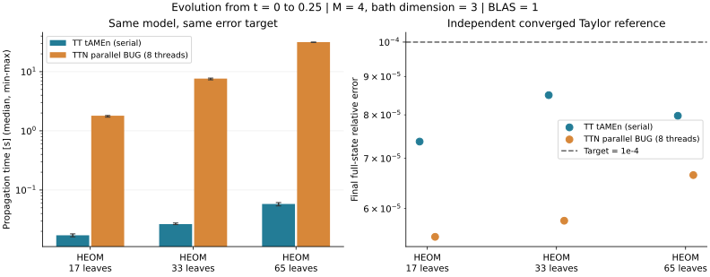

# TT tAMEn と並列 TTN BUG の比較

前回の大きな木のベンチマークと同じHEOMモデルについて、初期状態から t=0.25 までの伝播を比較した。
全状態の相対2ノルム誤差 **1e-4 以下**を両手法の共通採用条件とした。
スケール済み全ADOが対象で、密度行列だけの一致ではない。TFDの速度比較は今回の対象外。

## 実測結果

時間はウォームアップ後3回の中央値（最小–最大）。比が1より大きいとtAMEnが速い。

| 系 | TT tAMEn 秒 | parallel BUG 秒（8スレッド） | BUG / tAMEn | 誤差 TT / TTN |
|---|---:|---:|---:|---:|
| HEOM / 17葉 | 0.017 (0.016–0.018) | 1.803 (1.701–1.816) | 105.01× | 7.37e-05 / 5.50e-05 |
| HEOM / 33葉 | 0.026 (0.026–0.028) | 7.638 (7.276–7.796) | 288.26× | 8.50e-05 / 5.78e-05 |
| HEOM / 65葉 | 0.058 (0.054–0.061) | 31.521 (31.227–31.592) | 543.21× | 7.98e-05 / 6.65e-05 |

この設定ではtAMEnの伝播が約105–543倍速い。TTの最終ランクは10、MPOランクは8–9に収まり、時間方向も1区間で解けた。BUGは全ケース20ステップを要した。木の並列化だけの優劣を表す数値ではない。

実行環境: Julia 1.12.6、AMD Ryzen Threadripper PRO 9985WX 64-Cores。

## 比較条件

- M=4、各浴モードの局所次元3。HEOMの系はfused表現。
- モデル・葉順・結合強度は[前回の大きな木の比較](parallel_large_trees.md)と同じ。
  TTは同じ葉順を列に並べ、同じSoPからMPOを構成した。
- 前回はt=0.20のスナップショットから1ステップだけを計時した。
  今回はt=0からの全伝播であり、前回の秒数とは直接比較できない。
- TTはTTSolverのtAMEn、時間方向は8点Chebyshev、内部の適応区間選択は有効。
  TTNはparallel BUG、固定刻み。どちらもノルムの事後補正なし。
  HEOMのトレース汎関数は両方の基底で保護する。
- BUGの刻みと最大ランク、tAMEnの許容誤差は実測誤差で選択。
  同じ数値の内部tolを使う比較ではなく、全状態の同じ誤差上限を満たす比較である。
  試したパラメータ格子内の設定であり、すべての設定に対する最速性は主張しない。
- BUGは8 Juliaワーカースレッド。tAMEnのコアスイープは逐次、Strided=1。
  両方BLAS=1、GC=1。同じプロセスで交互に3組実行。実行中のGC時間は含む。
- コンパイル、モデル生成、MPO生成、参照解、誤差評価は計時外。
  tAMEnのspace-time構築・終端解抽出・丸め、BUGの全ステップの準備・更新・切り捨ては計時内。
  共有ホスト上の測定であり、最小–最大は観測範囲であって信頼区間ではない。

| 系 / 手法 | 時間設定 | 最終最大ランク | 密度行列誤差 | 不変量ドリフト | 累積割当 GB |
|---|---|---:|---:|---:|---:|
| HEOM / 17葉 / tamen | Chebyshev 8点, tol=1e-03 | 10 | 2.62e-05 | 1.04e-13 | 0.014 |
| HEOM / 17葉 / parallel_bug | 20ステップ, h=0.0125, maxrank=8, atol=5e-08 | 8 | 3.68e-05 | 8.77e-15 | 2.267 |
| HEOM / 33葉 / tamen | Chebyshev 8点, tol=1e-03 | 10 | 3.78e-05 | 3.76e-12 | 0.025 |
| HEOM / 33葉 / parallel_bug | 20ステップ, h=0.0125, maxrank=8, atol=5e-08 | 8 | 4.04e-05 | 4.57e-15 | 8.411 |
| HEOM / 65葉 / tamen | Chebyshev 8点, tol=1e-03 | 10 | 1.87e-05 | 1.15e-10 | 0.047 |
| HEOM / 65葉 / parallel_bug | 20ステップ, h=0.0125, maxrank=8, atol=5e-08 | 8 | 5.08e-05 | 8.88e-15 | 32.119 |

MPO構築もウォームアップ後3回の中央値を別に測定した。短い伝播では、この一度きりの
準備がtAMEnの伝播本体より長い場合がある。下表の合計はそれぞれの中央値の和で、
共通モデル生成やJulia起動は含まない。生成子が同じ反復計算ではMPOを再利用できる。

| 系 | MPO最大ランク | MPO構築 秒 | tAMEn伝播＋MPO構築 秒 |
|---|---:|---:|---:|
| HEOM / 17葉 | 8 | 0.024 | 0.041 |
| HEOM / 33葉 | 9 | 0.094 | 0.121 |
| HEOM / 65葉 | 9 | 0.469 | 0.527 |

ランクは異なる分割に対する値なのでTTとTTNで直接同じ意味にはならない。
累積割当量はピークメモリではない。ランク上限によりBUGの局所切り捨て予算を超える場合も、
独立参照解に対する全状態誤差で採否を判定し、切り捨て超過数と切り捨て誤差上界の累積をCSVに残している。

## 精度検証と解釈

参照解はtAMEn/BUGから独立した、MPO作用・TT丸めによるTaylor伝播。
粗い設定（10ステップ、丸め1e-9）と細かい設定（20ステップ、丸め1e-10）を比較し、
差が目標誤差の1/100未満であることを確認した。
小さいHEOM/TFDでは密行列指数と参照解・tAMEnを照合している。
[小系の検証](../benchmarks/tamen_comparison/data/verification.txt)は19項目成功し、
[集計検証](../benchmarks/tamen_comparison/data/result_validation.txt)では18本の本計時と108個の記録済みソースハッシュを確認した。
TTNとTTの全状態誤差は密展開せず直接縮約する。二乗ノルムの差を用いるため約1e-7以下の
精度を主張する用途には使わない。各本計時でも1e-4以下を再検証する。

この比較には、木と列の形だけでなく、MPOとSoPの実装差、空間と時間をまとめて解くtAMEnと
小刻みに進めるparallel BUGの時間離散化の差も含まれる。
短時間で低ランクに保たれるこのモデルの結果を、長時間・強結合・別の木形へ一般化しない。
浴の打切り自体の物理的収束を比較したものでもない。

## 再現用ファイル・参考文献

[実行手順](../benchmarks/tamen_comparison/README.md)、
[生データ・環境・ソースハッシュ](../benchmarks/tamen_comparison/data/)、
[比較と独立参照解](../benchmarks/tamen_comparison/common.jl)、
[小系の検証](../benchmarks/tamen_comparison/verify.jl)。
参照解の収束量・準備時間は各 `reference_*.txt`、精度調整の全履歴は `calibration_*.csv` に保存。

- S. V. Dolgov, *A Tensor Decomposition Algorithm for Large ODEs with Conservation Laws*,
  [arXiv:1403.8085](https://arxiv.org/abs/1403.8085)。
  著者の実装: [dolgov/tamen](https://github.com/dolgov/tamen)。本測定はローカルのJulia実装を使用。
- G. Ceruti, J. Kusch, C. Lubich, D. Sulz,
  *A Parallel Basis Update and Galerkin Integrator for Tree Tensor Networks*,
  [doi:10.1137/24M1714502](https://doi.org/10.1137/24M1714502)。
